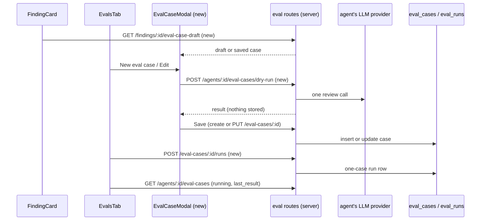

# Spec: Eval case editor (Amendment 2 to the eval pipeline)
Spec ID: SPEC-03-eval-case-editor
Status: approved
Supersedes: none

This spec extends `specs/eval-pipeline.md` (no Spec ID; implemented through Amendment 1,
criteria 1–36, decisions D1–D10). It moves one bullet of that spec's *Out of scope* into
scope: hand-written cases, a case editor, editing a case and running one case. Every
criterion of `specs/eval-pipeline.md` stays valid unless a criterion below says otherwise.
Criterion IDs continue that spec's numbering at AC-37. Decision **D11** is recorded under
*Inputs and provenance*.

## Problem and user

The user is the author of a reviewer agent who keeps a regression set of eval cases.

Today the "Turn into eval case" button on a FindingCard stores a case at once. The user
cannot check the frozen diff, the name or the expectation before the case joins the set.
In the AgentEditor **Evals** tab each case card has only Delete. The user cannot re-run
one case, fix a case, or write a case by hand. The homework reviewer asked for all of
this (see *Inputs and provenance*).

## Goals / Non-goals

Goals:

- A FindingCard opens an `EvalCaseModal` pre-filled from the finding, so the user can
  check and adjust the case before it is saved.
- The Evals tab can create a case by hand, edit a saved case and run one saved case.
- The user can try a draft case against the agent before saving it. The try stores nothing.
- An edit never changes the result of a run that already happened.
- A one-case run never changes suite metrics, run history or Compare.

Non-goals:

- More than one expectation per case. A case keeps exactly one `EvalExpectation`.
- Changing the type or the frozen diff of a case that came from a finding.
- Creating a case from a finding that is neither accepted nor dismissed.
- Unique case names.
- A confirmation before deleting a case (unchanged from `specs/eval-pipeline.md`).
- Skill-owned cases, an LLM judge, CI export, running on another model, the "30 days"
  filter. These stay out of scope as in `specs/eval-pipeline.md`.
- A new table or column. Only `eval_cases` and `eval_runs` are filled.

## User stories

- **US-1** As an agent author, I want the finding button to open a pre-filled case that I can check and adjust, so that only cases I agree with enter the set. → AC-37, AC-38, AC-39, AC-40, AC-41, AC-64, AC-65, AC-66, AC-67, AC-68
- **US-2** As an agent author, I want to write an eval case by hand, so that I can test behaviour no real PR has shown yet. → AC-42, AC-43, AC-44, AC-45, AC-46, AC-69, AC-76, AC-81, AC-82
- **US-3** As an agent author, I want to edit a saved case without changing past results, so that run history and Compare stay true. → AC-47, AC-48, AC-49, AC-50, AC-51, AC-80
- **US-4** As an agent author, I want to re-run one saved case, so that I can check a fix without running the whole suite. → AC-52, AC-53, AC-54, AC-55, AC-56, AC-77, AC-78, AC-79
- **US-5** As an agent author, I want to try a draft case before I save it, so that I can see whether the agent passes it. → AC-57, AC-58, AC-59, AC-60, AC-70, AC-71
- **US-6** As an agent author, I want the editor to keep my input on errors and to ask before throwing edits away, so that I do not lose a hand-written diff. → AC-72, AC-73, AC-74, AC-75
- **US-7** As an agent author, I want runs of one agent never to overlap, so that results and costs stay clear. → AC-61, AC-62, AC-63

## Acceptance criteria (EARS)

### J1. Draft from a finding

- **AC-37** [server] WHEN the client calls `GET /findings/:id/eval-case-draft` for a triaged finding that has no case yet, the server shall answer `200` with the frozen draft (agent id, name, `input_diff`, `input_files`, PR title, PR body, expectation, notes) built by the rules of criteria 2–4 of `specs/eval-pipeline.md`, and shall write nothing. *Verify: it*
- **AC-38** [server] IF the finding of `GET /findings/:id/eval-case-draft` is not triaged, has no agent, has no stored patch, has a diff over 200 KB or has an expectation outside every hunk, THEN the server shall answer `422` with the same code as `POST /findings/:id/eval-case` (`finding_not_triaged`, `finding_has_no_agent`, `no_diff_available`, `frozen_diff_too_large`, `expectation_not_grounded`). *Verify: it*
- **AC-39** [server] WHEN the client calls `GET /findings/:id/eval-case-draft` for a finding that already has a case, the server shall answer `200` with that saved case and no draft. *Verify: it*

### J2. Saving a case

- **AC-40** [server] WHEN `POST /findings/:id/eval-case` carries a body, the server shall store the case with the body's name, notes, line range, severity, category, title, PR title and PR body, and with the type and `input_diff` taken from the frozen finding. *Verify: it*
- **AC-41** [server] IF `POST /findings/:id/eval-case` is called for a finding that already has a case, THEN the server shall answer `200` with the existing case unchanged, with or without a body. *Verify: it*
- **AC-42** [server] WHEN the client calls `POST /agents/:id/eval-cases` with a valid hand-written case, the server shall store a new case owned by that agent, with `input_files` set to the files of the diff and no source finding, and shall answer `201` with the case. *Verify: it*
- **AC-43** [server] IF a saved, updated or dry-run case has an `input_diff` that does not parse as a unified diff with `---`/`+++` (or `diff --git`) file headers and at least one hunk, THEN the server shall answer `422 invalid_diff`. *Verify: unit + it*
- **AC-44** [server] IF a saved, updated or dry-run case has an `input_diff` larger than 200 KB, THEN the server shall answer `422 frozen_diff_too_large`. *Verify: unit*
- **AC-45** [server] IF the expectation's file is not a file of the case's diff, or its line range does not intersect a hunk of that file, THEN the server shall answer `422 expectation_not_grounded` for a save, an update or a dry run. *Verify: unit + it*
- **AC-46** [server] IF a case name is empty after trimming or longer than 120 characters, THEN the server shall answer `422 invalid_name` for a save or an update. *Verify: unit*

### J3. Editing a case

- **AC-47** [server] WHEN the client calls `PUT /eval-cases/:id` with a valid case, the server shall update that case and answer `200` with it; a case of another workspace answers `404`. *Verify: it*
- **AC-48** [server] IF `PUT /eval-cases/:id` would change the expectation type or the `input_diff` of a case that came from a finding, THEN the server shall answer `422 locked_field` and leave the case unchanged. *Verify: it*
- **AC-49** [server] IF an update changes a case's expectation or diff, THEN the server shall keep the stored pass, per-run metrics and case flips of every earlier run of that case exactly as they were before the update. *Verify: it*
- **AC-50** [server] The server shall store in every new run row the expectation that row is scored with, and shall score the row against that stored expectation. *Verify: unit + it*
- **AC-51** [server] IF a case is updated while one of its run rows is still pending, THEN the server shall score that row against the expectation read when its run started. *Verify: it*

### J4. Running one saved case

- **AC-52** [server] WHEN the client calls `POST /eval-cases/:id/runs`, the server shall start a run of that one case with the agent's current config and answer `202 { run_id, cases_total: 1 }`, and shall mark its row as a one-case run. *Verify: it*
- **AC-53** [server] The server shall leave one-case runs out of `GET /agents/:id/eval-runs`, `GET /eval/dashboard`, "Run all agents" and every suite metric. *Verify: it*
- **AC-54** [server] IF a one-case run id is passed to `GET /eval-runs/:runId` or `GET /eval-runs/compare`, THEN the server shall answer `404`. *Verify: it*
- **AC-55** [server] WHEN the client lists cases with `GET /agents/:id/eval-cases`, the server shall take each case's `last_result` and `last_matched` from that case's newest completed row, whether it came from a suite run or a one-case run. *Verify: it*
- **AC-56** [server] WHILE a case has a pending row, the server shall return that case from `GET /agents/:id/eval-cases` with `running: true`. *Verify: it*

### J5. Dry run of a draft

- **AC-57** [server] WHEN the client calls `POST /agents/:id/eval-cases/dry-run` with a valid draft, the server shall run the draft once with the agent's current config and the fixed inputs of criterion 11 of `specs/eval-pipeline.md`, and answer `200` with the result. *Verify: it*
- **AC-58** [server] The server shall write no row to `eval_cases`, `eval_runs`, `agent_runs`, `reviews`, `findings` or `run_traces` during a dry run. *Verify: it*
- **AC-59** [server] IF a dry run has no result after 120 seconds, THEN the server shall answer `504 dry_run_timeout`. *Verify: unit*
- **AC-60** [server] IF the model call of a dry run fails, THEN the server shall answer `502 dry_run_failed` with the sanitised reason that errored suite rows already use. *Verify: it*

### J6. One run per agent

- **AC-61** [server] IF a suite run, a one-case run or a dry run is in flight for an agent, THEN the server shall refuse a new run of any of the three kinds for that agent with `409 run_in_flight`. *Verify: it*
- **AC-62** [server] IF the agent's provider has no usable key, THEN the server shall refuse a one-case run or a dry run with `422 provider_not_configured`. *Verify: it*
- **AC-63** [server] IF one client starts more than 5 runs within one minute across `POST /agents/:id/eval-runs`, `POST /eval-cases/:id/runs` and `POST /agents/:id/eval-cases/dry-run` together, THEN the server shall answer `429` to the extra calls. *Verify: it*

### J7. Client — from a FindingCard

- **AC-64** [client] WHEN the user clicks "Turn into eval case" on an accepted or dismissed finding with no case, the client shall open the `EvalCaseModal` pre-filled from `GET /findings/:id/eval-case-draft`. *Verify: unit + e2e*
- **AC-65** [client] IF `GET /findings/:id/eval-case-draft` answers an error, THEN the client shall not open the modal and shall show the error toast for that code, as the button does today. *Verify: unit*
- **AC-66** [client] WHEN the draft route returns a saved case, the client shall open the modal on that case in edit mode with the note "Already in the eval set". *Verify: unit*
- **AC-67** [client] WHILE a finding is neither accepted nor dismissed, the client shall keep the "Turn into eval case" button disabled with the existing "accept or dismiss first" tooltip. *Verify: unit*
- **AC-68** [client] WHERE the modal shows a case that came from a finding, the client shall show the type (`must_find` / `must_not_flag`) and the diff as read-only. *Verify: unit*

### J8. Client — the EvalCaseModal

- **AC-69** [client] The `EvalCaseModal` shall show a name field, an input area with a **Diff** tab and a **PR meta** tab (optional title and body), an expected-output form (type, file chosen from the diff's files, start line, end line, severity, category, title), a notes field, and the footer buttons **Run case**, **Save** and **Cancel**. *Verify: unit*
- **AC-70** [client] WHEN the user clicks **Run case**, the client shall send the current form content to `POST /agents/:id/eval-cases/dry-run` and show the result: pass or fail, the findings with their matched flag, kept and dropped counts, and cost. *Verify: unit*
- **AC-71** [client] WHILE a dry run is waiting for its answer, the client shall disable **Run case** and label it "Running…". *Verify: unit*
- **AC-72** [client] WHEN **Save** succeeds, the client shall close the modal, show "Eval case created" for a new case or "Eval case saved" for an edit, and refresh the agent's case list. *Verify: unit*
- **AC-73** [client] IF **Save** or **Run case** answers an error, THEN the client shall keep the modal open with every entered value and show the error message next to the field it names (name, diff, expectation), or above the footer for any other code. *Verify: unit*
- **AC-74** [client] IF the user presses **Cancel**, presses Escape or clicks outside the modal after changing a field, THEN the client shall ask "Discard changes?" and close only after the user confirms. *Verify: unit*
- **AC-75** [client] WHEN the modal closes, the client shall move keyboard focus back to the button that opened it. *Verify: unit*

### J9. Client — the Evals tab

- **AC-76** [client] The Evals tab shall show a **New eval case** button in the "Eval cases" header that opens an empty `EvalCaseModal` for this agent. *Verify: unit + e2e*
- **AC-77** [client] The Evals tab shall show **Run**, **Edit** and **Delete** on every case card. *Verify: unit*
- **AC-78** [client] WHEN the user clicks **Run** on a case card, the client shall start a one-case run, show that card as running while the case has `running: true`, and then show its new status and "got N" line. *Verify: unit + e2e*
- **AC-79** [client] WHILE a suite run or a one-case run is in flight for the agent, the client shall disable **Run all evals**, every card's **Run** and the modal's **Run case**. *Verify: unit*
- **AC-80** [client] WHEN the user clicks **Edit** on a case card, the client shall open the `EvalCaseModal` on that saved case with its stored values. *Verify: unit*

### J10. Contracts and copy

- **AC-81** [server] The server shall define the new and changed eval contracts in `server/src/vendor/shared/contracts/eval-ci.ts`, mirrored byte-for-byte into the client copy, with `EvalCaseMeta.source_finding_id` optional. *Verify: unit*
- **AC-82** [client] The client shall take every new string from `messages/en/eval.json` (or the `prReview` namespace for the FindingCard) and read data only through the eval data hooks. *Verify: unit*

## Module interactions

Routes (new and changed). Existing routes of `specs/eval-pipeline.md` §H stay as they are
unless named here.

| Method | Path | Body | Answer | Status |
|---|---|---|---|---|
| GET | `/findings/:id/eval-case-draft` | — | `200` draft response; `422` codes of AC-38; `404` | new |
| POST | `/findings/:id/eval-case` | optional from-finding body | `201` / `200` `EvalCaseCreated` | changed (optional body) |
| POST | `/agents/:id/eval-cases` | case fields | `201` `EvalCase`; `422` | new |
| PUT | `/eval-cases/:id` | case fields | `200` `EvalCase`; `422`; `404` | new |
| POST | `/eval-cases/:id/runs` | — | `202 { run_id, cases_total: 1 }`; `409`; `422`; `429` | new |
| POST | `/agents/:id/eval-cases/dry-run` | case fields | `200` dry-run result; `409`; `422`; `429`; `502`; `504` | new |
| GET | `/agents/:id/eval-cases` | — | `EvalCaseView[]` with `running` | changed |
| GET/POST | `/agents/:id/eval-runs`, `/eval-runs/:runId`, `/eval-runs/compare`, `/eval/dashboard`, `/eval/runs/all` | — | one-case runs left out (AC-53, AC-54) | changed |

Contracts, by field (all in `eval-ci.ts`):

| Contract | Fields | Status |
|---|---|---|
| Case fields (request body) | `name` (1–120 chars after trim), `notes` (optional), `pr_title` (optional), `pr_body` (optional), `input_diff` (hand-written only), `expectation` = `EvalExpectation` | new |
| From-finding body | the same fields without `input_diff`; the type comes from triage | new |
| Draft response | `agent_id`, `existing_case` (`EvalCase` or null), `draft` (or null): `name`, `input_diff`, `input_files`, `pr_title`, `pr_body`, `expectation`, `notes` | new |
| Dry-run result | `pass`, `findings[]` (`file`, `start_line`, `end_line`, `severity`, `category`, `title`, `matched`), `grounding_kept`, `grounding_dropped`, `cost_usd` (nullable), `duration_ms`, `agent_version` | new |
| `EvalCaseView` | adds `running` (boolean) | changed |
| `EvalCaseMeta` | `source_finding_id` becomes optional; a hand-written case has none | changed |
| `EvalRunActualOutput` | adds two optional fields: a one-case-run marker and the expectation the row was scored with | changed |

Error codes: `invalid_diff`, `invalid_name`, `locked_field`, `dry_run_timeout`,
`dry_run_failed` are new. `frozen_diff_too_large`, `expectation_not_grounded`,
`finding_not_triaged`, `finding_has_no_agent`, `no_diff_available`, `run_in_flight`,
`provider_not_configured` exist today.

Tables: `eval_cases` gets updates for the first time. `eval_runs` rows of one-case runs
use the same columns as suite rows. No table, column or migration is added.

## Edge cases

- **EC-1** The finding is neither accepted nor dismissed, or its file has no stored patch. → AC-38, AC-65
- **EC-2** The finding already has a case, also after the user renamed it or re-triaged the finding. → AC-41
- **EC-3** A hand-written diff is malformed, has no file header, or is a bare `@@` hunk. → AC-43
- **EC-4** A pasted diff is larger than 200 KB. → AC-44
- **EC-5** The expectation points at a file that is not in the diff, or at lines outside every hunk. → AC-45
- **EC-6** The name is blank or very long. → AC-46
- **EC-7** A client sends a different type or diff for a case that came from a finding. → AC-48
- **EC-8** A case with stored runs is edited; older rows hold no stored expectation yet. → AC-49
- **EC-9** A case is edited while its run is still pending. → AC-51
- **EC-10** A one-case run id reaches Compare or run detail. → AC-54
- **EC-11** The model is slow during a dry run. → AC-59
- **EC-12** The model call fails during a dry run. → AC-60
- **EC-13** The user clicks Run while another run of the agent is in flight, or double-clicks. → AC-61
- **EC-14** No API key is configured for the agent's provider (the app boots with none). → AC-62
- **EC-15** The user starts many runs in a short time. → AC-63
- **EC-16** A save or a dry run fails after the user typed a long diff. → AC-73
- **EC-17** The user closes the modal with unsaved changes. → AC-74

## Non-functional requirements

- **NFR-1** Reliability: a dry run answers or fails within 120 seconds. *Verify: unit*
- **NFR-2** Cost: **Run case** and a card's **Run** each make exactly 1 model call; Save, Edit and opening the modal make 0. *Verify: it*
- **NFR-3** Limits: `input_diff` is at most 200 KB (204,800 bytes); a case name is 1–120 characters after trimming. *Verify: unit*
- **NFR-4** Limits: at most 5 run starts per minute per client across the three run routes. *Verify: it*
- **NFR-5** Accessibility: 100 % of the modal's fields and buttons are reachable with Tab, Escape closes it (through AC-74), and focus returns to the opener. *Verify: unit + manual*
- **NFR-6** i18n: 0 literal user-facing strings in the new client code; every string comes from `client/messages/en/*.json`. *Verify: unit*

## Assumptions

- **A-1** A dry run of one case with the agent's model normally finishes well within 120 seconds. Risk if wrong: users with slow models see `dry_run_timeout` often.
- **A-2** The API runs as one process, so a lock held in memory is enough for "one run per agent", as it is for suite runs today. Risk if wrong: two processes could run one agent twice.
- **A-3** Run rows written before this change hold no stored expectation; pinning them on the first edit of their case is enough to freeze history. Risk if wrong: a row that was not pinned gets re-scored.
- **A-4** A case came from a finding exactly when its `input_meta` holds a `source_finding_id`. Risk if wrong: a hand-written case could be locked, or a finding case left unlocked.
- **A-5** The rate limit counts calls per client the same way the existing eval rate limit does. Risk if wrong: the shared 5/min budget behaves differently from today's limit.
- **A-6** A dry run uses the agent's current version, which may differ from the version of the case's last stored run. Risk if wrong: the user compares a dry-run result with an older stored result and draws the wrong conclusion.

## Inputs and provenance

- **Request** (coordinator prompt, 2026-10-12): write Amendment 2 to `specs/eval-pipeline.md` for the homework reviewer feedback.
- **Reviewer feedback 1**: "Turn into eval case" opens an `EvalCaseModal` pre-filled with the frozen diff, a name and the expectation from triage (Accept → `must_find`, Dismiss → `must_not_flag`, shown), with **Run case**, **Save**, **Cancel**. → AC-37–AC-41, AC-64–AC-75.
- **Reviewer feedback 2**: Evals tab cards get **Run** and **Edit**, and the tab gets a **New eval case** button. → AC-42–AC-56, AC-76–AC-80.
- **D11 — the case editor moves into scope (Amendment 2).** The homework reviewer said that a case stored by one click cannot be checked, and that a regression set needs hand-written cases, edits and one-case runs. These were out of scope in `specs/eval-pipeline.md`. They move in, with two guards: an edit never changes past results (frozen expectations on run rows), and a one-case run never changes suite metrics, history or Compare. A draft can be tried before saving without storing anything.
- **Approval**: the user approved this spec on 2026-10-12.
- **User answers, 2026-10-12** (all "Recommended" options):
  1. Spec file: a new `specs/eval-case-editor.spec.md` (SPEC-03), AC IDs from AC-37. The main session updates `specs/eval-pipeline.md` itself.
  2. Run case on a draft: a dry run, not stored, about 2 min timeout. → AC-57–AC-60, NFR-1.
  3. Card Run: stored, marked as a one-case run, left out of history, tiles, sparklines, callout, dashboard and Compare. → AC-52–AC-56.
  4. Edit history: frozen; new rows store their expectation; older rows are pinned before the edit. → AC-49–AC-51.
  5. Prefill: a read-only server draft route with the same 422s. → AC-37–AC-39.
  6. Existing case: open it in edit mode with "Already in the eval set"; saving updates it; the source link survives a rename. → AC-39, AC-41, AC-66.
  7. From-finding modal: everything editable except type and diff. → AC-40, AC-48, AC-68.
  8. One expectation per case, entered in a form. → AC-69.
  9. Diff rules as criteria 3–4 of the eval pipeline spec; errors inline, input kept. → AC-43–AC-45, AC-73.
  10. Optional PR title and body; `source_finding_id` optional. → AC-69, AC-81.
  11. One run per agent across all three kinds, `409 run_in_flight`, buttons disabled, shared 5/min limit. → AC-61, AC-63, AC-79.
  12. Cancel asks "Discard changes?" only when the form changed; focus returns to the opener. → AC-74, AC-75.
  13. An untriaged finding keeps the disabled button. → AC-67.
  14. Name required, trimmed, 1–120 characters, not unique, prefilled with the slug. → AC-46.
- **Code read** (worktree `dev-digest-wt-l06hw`, branch `l06-hw-eval-editor`): `server/src/modules/eval/service.ts:125-167` (`createCaseFromFinding`), `:186-228` (`startRun`, lock), `:267` (`executeRun`); `server/src/modules/eval/routes.ts`; `server/src/modules/eval/helpers.ts:166,175` (rows are re-scored against the current expectation on every read — the reason for AC-49/AC-50); `server/src/modules/eval/executor.ts:43` (PR body from `input_meta`); `server/src/modules/eval/constants.ts` (200 KB cap, 5/min limit); `server/src/vendor/shared/contracts/eval-ci.ts:20-29,100-139,158-168`; `server/src/db/schema/eval.ts`; `client/.../FindingCard/FindingCard.tsx:119-129`; `client/.../FindingsPanel/FindingsPanel.tsx:35,88-95`; `client/.../EvalsTab/EvalsTab.tsx:134-145,166-201`; `client/messages/en/eval.json:56-98` (drafted `caseEditor.*` and `evalsTab.*` keys).
- **INSIGHTS**: server 2026-10-11 (suite grouping by `run_id`, late writes guarded on `pending`); server 2026-09-20 (no `JobRunner` and no `agent_runs` for paid eval calls); client 2026-09-20 and 2026-10-03 (form state lost on unmount; vendor buttons take no ref, which matters for AC-75); root 2026-10-03 (spec-lint does not parse an `[e2e]` tag, so e2e checks sit in verify hints).
- **Designs**: none beyond the reviewer text and the drafted i18n keys.

## Untrusted inputs

- **Hand-written diff, PR title and PR body.** Typed or pasted by the user, possibly copied from an outside PR. The diff and the PR body are sent to the model inside the same untrusted wrapper the review prompt already uses. They are shown in the UI as plain text, never as HTML.
- **Name, notes and expectation title.** Shown as plain text only; never sent to the model.
- **Finding-derived values** (patch, PR title and body, finding title, rationale). These come from GitHub and the model, with the same rules as `specs/eval-pipeline.md`.
- **Model output of a dry run or a one-case run.** It passes the grounding gate. Only surviving findings are scored and shown, as in suite runs.
- **Error reasons.** Shown in the UI only after the existing sanitising (class plus a redacted, capped message).

## Open questions

- **Q-1** (planner) How does the client learn that a one-case run has finished: polling the case list while a case has `running: true`, or another way?
- **Q-2** (planner) Where and how is the scored expectation stored on a run row, and how are older rows pinned in the same step as the edit?
- **Q-3** (planner) What shape do the repository's case update and the pinning of older rows take (one transaction or not)?
- **Q-4** (planner) How do the three run routes share one rate-limit budget of 5 per minute?
- **Q-5** (non-blocking) Should a case card mark that the case was edited after its last stored run?

## Traceability

| AC | Stories | Edge cases | NFR | Verify |
|----|---------|------------|-----|--------|
| AC-37 | US-1 | — | NFR-2 | it |
| AC-38 | US-1 | EC-1 | — | it |
| AC-39 | US-1 | — | — | it |
| AC-40 | US-1 | — | — | it |
| AC-41 | US-1 | EC-2 | — | it |
| AC-42 | US-2 | — | — | it |
| AC-43 | US-2 | EC-3 | — | unit + it |
| AC-44 | US-2 | EC-4 | NFR-3 | unit |
| AC-45 | US-2 | EC-5 | — | unit + it |
| AC-46 | US-2 | EC-6 | NFR-3 | unit |
| AC-47 | US-3 | — | — | it |
| AC-48 | US-3 | EC-7 | — | it |
| AC-49 | US-3 | EC-8 | — | it |
| AC-50 | US-3 | — | — | unit + it |
| AC-51 | US-3 | EC-9 | — | it |
| AC-52 | US-4 | — | NFR-2 | it |
| AC-53 | US-4 | — | — | it |
| AC-54 | US-4 | EC-10 | — | it |
| AC-55 | US-4 | — | — | it |
| AC-56 | US-4 | — | — | it |
| AC-57 | US-5 | — | NFR-2 | it |
| AC-58 | US-5 | — | — | it |
| AC-59 | US-5 | EC-11 | NFR-1 | unit |
| AC-60 | US-5 | EC-12 | — | it |
| AC-61 | US-7 | EC-13 | — | it |
| AC-62 | US-7 | EC-14 | — | it |
| AC-63 | US-7 | EC-15 | NFR-4 | it |
| AC-64 | US-1 | — | — | unit + e2e |
| AC-65 | US-1 | EC-1 | — | unit |
| AC-66 | US-1 | EC-2 | — | unit |
| AC-67 | US-1 | EC-1 | — | unit |
| AC-68 | US-1 | EC-7 | — | unit |
| AC-69 | US-2 | — | NFR-5 | unit |
| AC-70 | US-5 | — | NFR-2 | unit |
| AC-71 | US-5 | — | — | unit |
| AC-72 | US-6 | — | — | unit |
| AC-73 | US-6 | EC-16 | — | unit |
| AC-74 | US-6 | EC-17 | NFR-5 | unit |
| AC-75 | US-6 | — | NFR-5 | unit |
| AC-76 | US-2 | — | — | unit + e2e |
| AC-77 | US-4 | — | — | unit |
| AC-78 | US-4 | — | — | unit + e2e |
| AC-79 | US-4 | EC-13 | — | unit |
| AC-80 | US-3 | — | — | unit |
| AC-81 | US-2 | — | — | unit |
| AC-82 | US-2 | — | NFR-6 | unit |
