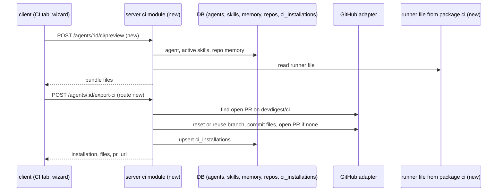
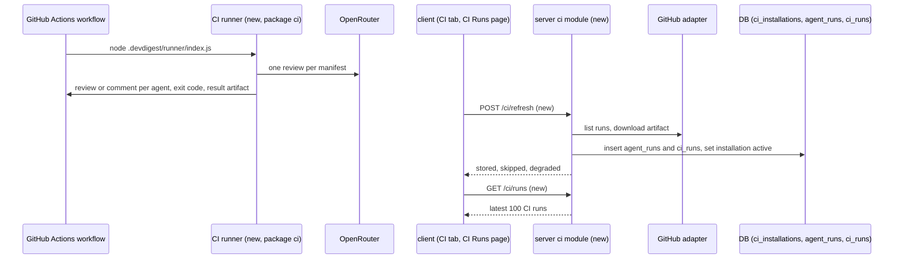
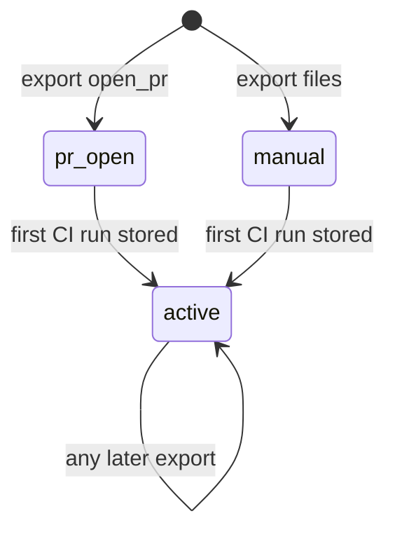

# Spec: Export to CI (simple first version)
Spec ID: SPEC-04-export-to-ci-mvp
Status: approved
Supersedes: none

## Problem and user

A team builds and tunes a reviewer agent in DevDigest. Today the agent runs only inside
the local studio. The team wants the same agent to review every pull request inside the
repository's own GitHub Actions, and to fail the check when the agent finds a serious
problem.

The user is the owner of an agent who also has write access to the target GitHub
repository. They want to open an **Export to CI** wizard (Target, Preview, Configure,
Install), get a pull request with the files or a zip, and then see installations and CI
runs in the studio.

This spec is a deliberately simple first version. The user asked for "a very simple
implementation, and we iterate when we learn what users need". Ideas left for later are
listed under Non-goals.

The studio is local-first and runs on `localhost`; a GitHub runner cannot reach it. CI
results therefore come back by **pull**: the server reads finished workflow runs and
their result artifact through the GitHub Actions API with the workspace's GitHub token.

The code already reserves this feature: the tables `ci_installations` and `ci_runs`
(empty), `agent_runs.source` (`local` | `ci`) and `agent_runs.blockers`,
`agents.ci_fail_on`, the contracts `CiTarget`, `CiFile`, `AgentManifest`,
`CiExportInput`, `CiInstallation`, `CiExport`, `CiRun` and `CiResultArtifact` in
`server/src/vendor/shared/contracts/eval-ci.ts`, the GitHub adapter methods
`commitFiles`, `findOpenPr` and `openPullRequest`, the `ci.json` message file and the
`/ci-runs` key in the app shell.

## Goals / Non-goals

Goals:
- Generate a CI bundle for one agent and one workspace repository.
- Commit it to branch `devdigest/ci` and open or reuse a pull request, or give it as a
  zip. Never write to the default branch.
- Ship a runner (new standalone package `ci/`) as one JavaScript file that the workflow
  runs with Node.
- Pull finished CI results through the GitHub Actions API into `agent_runs` and
  `ci_runs`.
- Show installations, the "Fail CI on" setting and run history on the agent's CI tab,
  and the latest CI runs on a CI Runs page.
- Allow export for every agent, also a disabled one.

Non-goals (left for a later version):
- Checking repository secrets through the GitHub API. The wizard shows a static hint.
- Auto-refresh every 60 seconds and the per-repository refresh throttle. A refresh runs
  only when the CI tab or the CI Runs page opens, and on the Refresh button.
- A bulk "Update CI config" over every repository, and outdated detection.
  "Update CI config" reopens the wizard for one chosen repository.
- An installation status that reads the default branch. An installation becomes
  `active` only after its first stored CI run.
- Filters and pagination on the CI Runs page. It shows the latest 100 runs.
- An e2e browser flow and changes to `scripts/dev.sh` or `scripts/e2e.sh`.
- Performance targets for large tables and an axe audit.
- YAML validation in the client. The server validates; the client shows its error.
- Marking repositories that already have an installation in the repository select.
- A guard against two parallel exports to one repository.

Non-goals (out of scope):
- CircleCI, Jenkins and Generic CLI targets. Their cards are not shown.
- A published GitHub Action. `uses: devdigest/review-action@v1` stays a comment only.
- An inbound endpoint that receives results from CI.
- Importing single CI findings as `findings` rows.
- Project Context documents and repo-intel context in CI runs.
- Removing an installation.
- Any change to the multi-run service, the PR feed, PR run history or PR cost.
- MCP tools for CI, and changes to `reviewer-core`.
- Locales other than `en`. Pixel-perfect styling.

## User stories

- **US-1** As an agent owner, I want to open a pull request that adds my agent to a repository's GitHub Actions, so that the agent reviews every pull request there. → AC-1, AC-2, AC-3, AC-4, AC-5, AC-6, AC-7, AC-8, AC-9, AC-12, AC-13, AC-38, AC-42
- **US-2** As an agent owner, I want to edit the workflow and choose triggers and posting, so that the review fits my repository. → AC-10, AC-11, AC-39, AC-40, AC-41, AC-44
- **US-3** As an agent owner, I want the files as a zip, so that I can add them by hand. → AC-12, AC-43
- **US-4** As a reviewer of the target repository, I want each agent's result posted on the pull request, so that I see the problems without DevDigest. → AC-25, AC-26, AC-27, AC-28, AC-29, AC-30, AC-31
- **US-5** As an agent owner, I want to see my installations, history and "Fail CI on" on the CI tab, so that I control the agent in CI. → AC-14, AC-32, AC-33, AC-34, AC-35, AC-36, AC-37
- **US-6** As an agent owner, I want a CI Runs page, so that I watch quality and spend across repositories. → AC-15, AC-20, AC-21, AC-22, AC-24, AC-45, AC-46, AC-47, AC-48
- **US-7** As a workspace owner, I want CI results accepted only through a channel DevDigest checks itself, so that nobody can push fake runs into the studio. → AC-16, AC-17, AC-18, AC-19, AC-23

## Acceptance criteria (EARS)

Terms used below:
- **Bundle** — `.devdigest/agents/<agent-slug>.yaml` (the manifest), one
  `.devdigest/skills/<skill-slug>.md` per active skill, `.devdigest/memory.jsonl`,
  `.devdigest/runner/index.js` (the runner) and `.github/workflows/devdigest-review.yml`
  (the workflow).
- **Active skill** — a skill linked to the agent where both the link and the skill are
  enabled.
- **Workflow** — the one shared file per repository. It reviews with every manifest
  under `.devdigest/agents/`.
- **Runner** — the program in the new standalone package `ci/`, bundled to one
  JavaScript file. Criteria whose part is "the CI runner" belong to package `ci`; they
  carry the tag `[server]` only because the spec format knows no `[ci]` tag yet.
- **Installation** — one `ci_installations` row for an agent and a repository. Status
  `pr_open`, `manual` or `active`.
- **CI run** — one agent result from one GitHub Actions run: an `agent_runs` row with
  `source` `ci` plus a linked `ci_runs` row.
- **Verdict** — `blocked` (the agent has blockers), `passed` (findings, no blockers),
  `no_findings`, or `failed` (the runner could not finish the review).
- **Blockers** — surviving findings whose severity trips the agent's `ci_fail_on`.
- **Refresh** — one pull of finished runs and artifacts from GitHub into the workspace.

Bundle (server):

- **AC-1** [server] WHEN the client asks for an export preview for an agent and a workspace repository, the server shall return exactly the bundle files, with the runner as its size only. *Verify: it*
- **AC-2** [server] The manifest shall contain the agent id, name, agent version, provider, model, system prompt, strategy, the ordered active skill slugs, `post_as` and `ci_fail_on`, and it shall pass the `AgentManifest` contract. *Verify: unit*
- **AC-3** [server] The memory file shall hold one JSON line with only `kind` and `content` for each `memory` row of the workspace with `scope` `repo` and the chosen repository, and it shall be empty when there is no such row. *Verify: it*
- **AC-4** [server] The workflow shall run on `pull_request` with the chosen trigger types, written in the order opened, synchronize, reopened. *Verify: unit*
- **AC-5** [server] The workflow shall declare only `contents: read` and `pull-requests: write`, one concurrency group per pull request with `cancel-in-progress: true` and `timeout-minutes: 15`, run `node .devdigest/runner/index.js` on Node 22 with `OPENROUTER_API_KEY` from repository secrets and `GITHUB_TOKEN` from Actions, upload `devdigest-result.json` as artifact `devdigest-result` also when the review step fails, and hold `uses: devdigest/review-action@v1` only in a comment. *Verify: unit*
- **AC-6** [server] IF the pull request comes from a fork, THEN the workflow shall skip the review job. *Verify: unit*

Export (server):

- **AC-7** [server] WHEN the client sends an export with action `open_pr`, the server shall commit every bundle file to branch `devdigest/ci` of the target repository, and shall never write to the default branch. *Verify: it*
- **AC-8** [server] IF an open pull request from `devdigest/ci` already exists, THEN the server shall add a new commit to that branch and return that pull request's URL without opening a second one. *Verify: it*
- **AC-9** [server] IF no open pull request from `devdigest/ci` exists, THEN the server shall point `devdigest/ci` at the current head of the default branch before it commits, and open a pull request titled "Add DevDigest CI review" whose body lists every committed path and the secret `OPENROUTER_API_KEY` to add. *Verify: it*
- **AC-10** [server] WHEN the export request carries edited workflow text, the server shall commit that text in place of the generated workflow. *Verify: it*
- **AC-11** [server] IF the workflow text of the export is not valid YAML, THEN the server shall answer `422` `invalid_workflow` with the line number, and write nothing to GitHub or the database. *Verify: it*
- **AC-12** [server] WHEN an export succeeds, the server shall create the installation for the agent and the repository with status `pr_open` (action `open_pr`) or `manual` (action `files`), keep the status of an existing `active` installation, and store the agent version, triggers, `post_as` and pull request URL. *Verify: it*
- **AC-13** [server] IF no GitHub token is configured, or GitHub refuses or fails a write, THEN the export shall answer `409` `github_not_configured`, `github_permission` (for `403` or `404`, with the needed permissions: classic token `repo` and `workflow`; fine-grained Contents, Pull requests and Workflows write, and Actions read) or `502` `github_error`, and leave the installation unchanged. *Verify: it*

Installations and runs (server):

- **AC-14** [server] WHEN the client asks for an agent's CI data, the server shall return each installation with repository, status, installed agent version and pull request URL, and the agent's last 20 CI runs newest first. *Verify: it*
- **AC-15** [server] WHEN the client lists CI runs, the server shall return the latest 100 CI runs of the workspace newest first, each with repository, pull request number and URL, agent name, verdict, findings count, cost, duration, GitHub run URL and run time. *Verify: it*

Ingest (server):

- **AC-16** [server] WHEN a refresh runs, the server shall, for each workspace repository with an installation, list the completed runs of `.github/workflows/devdigest-review.yml` from the last 30 days, at most 100. *Verify: it*
- **AC-17** [server] IF a run's head repository differs from the installation repository, or a CI run with the same GitHub run id and agent is already stored, THEN the server shall skip it. *Verify: it*
- **AC-18** [server] IF a run's `devdigest-result` artifact is missing, larger than 1 MB, or fails the `CiResultArtifact` contract, THEN the server shall skip that run, write nothing for it, and count it as skipped. *Verify: it*
- **AC-19** [server] WHEN a valid artifact holds a result for an agent installed on that repository in the workspace, the server shall write one `agent_runs` row (`source` `ci`, `pr_id` NULL, agent, provider, model, status, duration, cost, findings count, blockers) and one linked `ci_runs` row (installation, pull request number, GitHub run URL, run time, verdict, GitHub run id), and drop every result for any other agent. *Verify: it*
- **AC-20** [server] WHEN the server stores a CI run for an installation, it shall set that installation's status to `active`. *Verify: it*
- **AC-21** [server] IF GitHub fails while the server lists runs for one repository, THEN the refresh shall write nothing for that repository, return `degraded` with the reason, and continue with the other repositories. *Verify: it*
- **AC-22** [server] The server shall keep every CI `agent_runs` row out of `GET /pulls/:id/runs` and out of the pull request list's cost. *Verify: it*
- **AC-23** [server] The server shall clamp artifact values before it stores them: counts to 0–10,000, cost to 0–100 USD, duration to 0–86,400,000 ms, text to 500 characters. *Verify: unit*
- **AC-24** [server] The refresh response shall carry the counts of stored and skipped runs and the list of degraded repositories with reasons. *Verify: it*

Runner (package `ci`):

- **AC-25** [server] WHEN the workflow starts the runner for a pull request, the CI runner shall review the pull request diff once for every manifest under `.devdigest/agents/`. *Verify: unit*
- **AC-26** [server] The CI runner shall call the model only through OpenRouter with `OPENROUTER_API_KEY`, mapping provider `openai` to `openai/<model>`, `anthropic` to `anthropic/<model>`, and `openrouter` unchanged. *Verify: unit*
- **AC-27** [server] The CI runner shall keep only findings that pass the `reviewer-core` grounding gate, and count blockers from them with the agent's `ci_fail_on`. *Verify: unit*
- **AC-28** [server] The CI runner shall post one item per agent, titled with the agent name, by that agent's `post_as`: a GitHub review that requests changes when the agent has blockers and comments otherwise (`github_review`), a pull request comment (`pr_comment`), or nothing (`none`). *Verify: unit*
- **AC-29** [server] The CI runner shall exit with a non-zero code when at least one agent has blockers. *Verify: unit*
- **AC-30** [server] IF a manifest fails the `AgentManifest` contract, the diff fetch or the model call fails, or `OPENROUTER_API_KEY` is empty, THEN the CI runner shall record verdict `failed` with an error code for that agent, continue with the other agents, and exit with a non-zero code. *Verify: unit*
- **AC-31** [server] The CI runner shall write `devdigest-result.json` with the result version, pull request number, head SHA and one result per manifest: agent id, agent version, verdict, findings count per severity, blockers, cost, duration, model and error code. *Verify: unit*

Agent CI tab (client):

- **AC-32** [client] The agent editor shall show a CI tab after Context, opened with `?tab=ci`, with the heading "CI deployment", the badge "Active in N repos" (N = `active` installations, hidden at 0), the buttons "Update CI config" and "Add to CI", one row per installation and a dashed "Add repository" row. *Verify: unit + manual*
- **AC-33** [client] The CI tab shall show in each installation row the repository, the chip "GitHub Actions", the installed agent version as `v<number>`, and the latest CI run verdict with relative time, or "PR open" with a link, or "Manual install". *Verify: unit*
- **AC-34** [client] WHEN the user clicks "Update CI config", the client shall open the wizard with the repository select limited to repositories where the agent has an installation. *Verify: unit*
- **AC-35** [client] The CI tab shall show the "Fail CI on" control (never, critical, warning, any) that saves `ci_fail_on` through `PUT /agents/:id`, and the Config tab shall no longer show the "CI gate" control. *Verify: unit*
- **AC-36** [client] The CI tab shall show the agent's last 20 CI runs and an "All runs" link to `/ci-runs`. *Verify: unit*
- **AC-37** [client] IF the CI data request fails, THEN the CI tab shall show the error text and a Retry button. *Verify: unit*

Export wizard (client):

- **AC-38** [client] WHEN the user clicks "Add to CI" or "Add repository", the client shall open the "Export to CI" wizard at step Target of Target, Preview, Configure, Install, with only the GitHub Actions card (selected) and a repository select of workspace repositories, preselected with the active repository. *Verify: unit*
- **AC-39** [client] The Preview step shall list the bundle files and show the text of the selected file, with only the workflow editable and the runner shown by its size. *Verify: unit*
- **AC-40** [client] The Configure step shall preselect the triggers opened and synchronize, leave reopened optional, disable Continue while no trigger is selected, offer "Post results as" (GitHub review preselected, PR comment, None (exit code only)), and show the static hint that `OPENROUTER_API_KEY` must be added to the repository's Actions secrets and `GITHUB_TOKEN` is provided by Actions. *Verify: unit*
- **AC-41** [client] WHEN the user changes the triggers after editing the workflow, the wizard shall replace only the `types:` list under `pull_request` in the edited text and keep every other edit. *Verify: unit*
- **AC-42** [client] WHEN the user clicks Install with "Open a PR with these files" (preselected), the wizard shall send the export with action `open_pr` and, on success, show the pull request link and reload the CI tab. *Verify: unit*
- **AC-43** [client] WHEN the user clicks Install with "Copy files as a zip", the client shall download `devdigest-ci-<owner>-<name>.zip` with every bundle file at its path, including workflow edits, and send the export with action `files`. *Verify: unit*
- **AC-44** [client] IF the export fails, THEN the wizard shall stay on Install, show the server's error text (for `invalid_workflow` with the line, for `github_permission` with the permission list), and keep every choice and edit. *Verify: unit*

Refresh and CI Runs page (client):

- **AC-45** [client] WHEN the CI tab or the `/ci-runs` page opens, or the user clicks Refresh on `/ci-runs`, the client shall request a refresh and then reload the shown data. *Verify: unit*
- **AC-46** [client] The sidebar shall show "CI Runs" in the GLOBAL group, linking to `/ci-runs`. *Verify: unit*
- **AC-47** [client] The `/ci-runs` page shall show a table with repository, pull request (a link to GitHub), agent, verdict, findings, cost, duration and a "View job" link, and the text "No CI runs yet" when the list is empty. *Verify: unit*
- **AC-48** [client] IF a refresh result is degraded, THEN the CI tab and the `/ci-runs` page shall show a notice with the reason and keep showing the stored data. *Verify: unit*

## Module interactions

Export flow:

CI run and ingest flow:

Installation status:

Contracts at the boundary:

| Contract | State | Direction | Fields |
|----------|-------|-----------|--------|
| `GET /agents/:id/ci` | new | server → client | `installations` (list of `CiInstallation`), `runs` (last 20 `CiRun` of the agent) |
| `POST /agents/:id/ci/preview` | new | client → server | request: `repo_id`, `triggers` (subset of `opened`, `synchronize`, `reopened`), `post_as`; response: `files` (list of `CiFile`; runner with size and no text) |
| `POST /agents/:id/export-ci` | contract `CiExportInput` / `CiExport` exists; route new | client → server | request: `repo` (`owner/name` of a workspace repository), `target` (`gha` only), `action` (`open_pr` \| `files`), `post_as`, `triggers`, `workflow` (edited text, optional, new); response: `installation`, `files`, `pr_url` (null for `files`); errors `404`, `409 github_not_configured`, `422 invalid_workflow` (with `line`), `github_permission`, `502 github_error` |
| `PUT /agents/:id` | existing, unchanged | client → server | the CI tab sends `ci_fail_on` |
| `POST /ci/refresh` | new | client → server | response: `stored`, `skipped`, `degraded` (list of `repo`, `reason`) |
| `GET /ci/runs` | new | server → client | response: `items` (latest 100 `CiRun`) |
| `CiInstallation` | existing, extended | server → client | adds `status` (`pr_open` \| `manual` \| `active`), `installed_agent_version`, `pr_url`, `triggers`, `post_as`, `last_run` (`verdict`, `ran_at`, or null) |
| `CiRun` | existing, reworked | server → client | `id`, `repo`, `pr_number`, `pr_url`, `agent_id`, `agent_name`, `verdict`, `findings_count`, `cost_usd`, `duration_ms`, `github_url`, `ran_at` |
| `CiResultArtifact` | existing, reworked | runner → server (GitHub artifact) | `version`, `pr_number`, `head_sha`, `results` (list of `agent_id`, `agent_version`, `verdict`, `critical`, `warning`, `suggestion`, `findings_count`, `blockers`, `cost_usd`, `duration_ms`, `model`, `error_code`) |
| `AgentManifest` | existing, extended | server → runner (repository file) | adds `agent_id`, `version`, `post_as` |
| `ci_installations` table | existing, empty | server | gains columns for status, installed agent version, pull request URL, triggers and `post_as`. No new table. |
| `ci_runs` table | existing, empty | server | gains columns for the linked `agent_runs` row, the GitHub run id and the verdict |
| `agent_runs` table | existing, unchanged | server | CI rows with `source` `ci`, `pr_id` NULL |
| GitHub adapter | existing port, extended | server → GitHub | existing `commitFiles`, `findOpenPr`, `openPullRequest`; new: reset a branch to a commit, list runs of one workflow file, download one run artifact |

## Edge cases

- **EC-1** No GitHub token is configured. → AC-13, AC-44
- **EC-2** The token lacks `workflow` scope or Workflows write. → AC-13, AC-44
- **EC-3** The edited workflow is not valid YAML. → AC-11, AC-44
- **EC-4** An open `devdigest/ci` pull request already exists, for example for a second agent. → AC-8
- **EC-5** The earlier `devdigest/ci` pull request was merged or closed. → AC-9
- **EC-6** A pull request comes from a fork and gets no secrets. → AC-6
- **EC-7** A manifest is broken, the model is down, or `OPENROUTER_API_KEY` is not set. → AC-30
- **EC-8** The artifact is missing, expired, too large or invalid. → AC-18
- **EC-9** GitHub is rate-limited or down during a refresh. → AC-21, AC-48
- **EC-10** A pull request author in the same repository fakes an artifact or names another agent. → AC-17, AC-19, AC-23
- **EC-11** Two refreshes see the same GitHub run. → AC-17
- **EC-12** The CI data request fails. → AC-37

## Non-functional requirements

- **NFR-1** Limits: a refresh reads runs from the last 30 days, at most 100 runs per repository, and artifacts of at most 1 MB. *Verify: it*
- **NFR-2** Limits: the runner file is at most 5 MB and runs with `node` on Node 22 with 0 packages installed. *Verify: manual*
- **NFR-3** Reliability: the workflow job stops after 15 minutes; the runner stops one agent's model call after 120 s and records `failed` for it. *Verify: unit*
- **NFR-4** Cost: preview, export and refresh make 0 model calls. *Verify: it*
- **NFR-5** Security: the server and the runner write 0 GitHub tokens, API keys or secret values to logs, responses, the result artifact or the database. *Verify: unit*
- **NFR-6** Security: every new route answers `404` for 100% of agents or repositories outside the caller's workspace. *Verify: it*
- **NFR-7** i18n: 100% of new user-facing strings come from `client/messages/en/*.json`. *Verify: unit*

## Assumptions

- **A-1** GitHub keeps workflow artifacts 90 days by default, and a repository may shorten this. Risk if wrong: older runs are never stored.
- **A-2** The workspace's GitHub token can read Actions runs and artifacts of the target repository. Risk if wrong: every refresh for it is degraded.
- **A-3** OpenRouter names the models DevDigest offers as `openai/<model>` and `anthropic/<model>`. Risk if wrong: CI runs end `failed` with a model error.
- **A-4** `reviewer-core` and its dependencies can be bundled into one file under 5 MB, as an earlier implementation on another branch did (`02a0995`, `32f33a4`). Risk if wrong: NFR-2 fails.
- **A-5** The Actions `GITHUB_TOKEN` with `pull-requests: write` may post a review that requests changes. Risk if wrong: AC-28 needs another post mode.
- **A-6** The repository's default branch is `repos.default_branch`. Risk if wrong: the pull request targets the wrong base.
- **A-7** A pull request author with write access can already change the workflow and use its secrets, so running the runner from the pull request checkout adds no new access. Risk if wrong: `OPENROUTER_API_KEY` could leak.
- **A-8** The `memory` table has no writer today, so the memory file is empty in practice. Risk if wrong: repository memory text is published to the target repository.

## Inputs and provenance

- Request (user, via coordinator, "worktree B"): Add to CI opens a four-step wizard
  (Target, Preview, Configure, Install); GitHub Actions first, other targets only if
  implemented; Preview with manifest, skills, `.devdigest/memory.jsonl` and an editable
  workflow; Configure with `pull_request` events and posting mode; Install opens a pull
  request on `devdigest/ci` or downloads a zip, never writes to main; a bundled runner,
  `devdigest/review-action@v1` only a placeholder; CI Runs and the agent's CI tab;
  ingest into `agent_runs` with `source='ci'` only through a verified channel; no change
  to the multi-run service or the PR feed.
- Earlier clarification rounds (user, via coordinator). They were made for a fuller
  draft that was never committed and was discarded. Their decisions stay valid unless
  this spec cuts them: pull-only ingest, package `ci/` runner, one
  shared workflow, `OPENROUTER_API_KEY` only, `agent_runs` + `ci_runs` with `pr_id`
  NULL, dedup by GitHub run id, "Fail CI on" moved to the CI tab, per-agent review or
  comment, fail closed on runner error, fork pull requests skipped, minimal permissions,
  concurrency and timeout, repository memory in `memory.jsonl`, open-PR reuse rule,
  export allowed for a disabled agent.
- Simplification request (user, via coordinator, verified in the main session): "a very
  simple implementation so we don't overcomplicate; we'll iterate once we learn what
  users need".
  - KEEP list → AC-1 to AC-48.
  - CUT (1) secret check → static hint (AC-40, Non-goals).
  - CUT (2) auto-refresh and throttle → refresh on open and Refresh button (AC-45).
  - CUT (3) bulk update and outdated → wizard for one repository, version as a number
    (AC-33, AC-34).
  - CUT (4) default-branch status → `active` after the first stored run; a later export
    keeps `active` (AC-12, AC-20).
  - CUT (5) filters and pagination → latest 100 runs (AC-15, AC-47).
  - CUT (6) e2e flow and script wiring → Non-goals; verify by `unit` and `it` only.
  - CUT (7) large-table NFR and axe audit → Non-goals.
  - CUT (8) client YAML validation → server only (AC-11, AC-44).
- Designs (read): CI tab with "CI deployment", "Active in 2 repos", "Update CI config",
  "Add to CI" and installation rows; Target with four cards; Preview with the file list
  and editable workflow (its `OPENAI_API_KEY` is replaced by `OPENROUTER_API_KEY`);
  Configure with trigger chips, secrets and "Post results as"; Install with "Open a PR
  with these files" and "Copy files as a zip".
- Code read: `server/src/db/schema/ci.ts`, `server/src/db/schema/runs.ts`,
  `server/src/db/schema/agents.ts`, `server/src/db/schema/knowledge.ts`,
  `server/src/vendor/shared/contracts/eval-ci.ts`, `server/src/adapters/github/octokit.ts`,
  `server/src/modules/agents/routes.ts`, `server/src/modules/reviews/repository/run.repo.ts`,
  `server/src/modules/pulls/routes.ts`, `client/messages/en/ci.json`,
  `client/src/vendor/ui/nav.ts`, `client/src/components/app-shell/helpers.ts`.
- Git history (reference only, not in `HEAD`): earlier implementations on other branches,
  `01d601e`, `1980dea`, `711a447`, `02a0995`, `32f33a4`.

## Untrusted inputs

- Result artifact JSON — produced by code a pull request author can change. Validated
  against `CiResultArtifact`, values clamped, results kept only for agents installed on
  that repository in the workspace, every text shown as plain text (AC-18, AC-19, AC-23).
- GitHub run metadata (head repository, run URL, pull request number) — a run counts only
  when its head repository equals the installation repository; links are shown only when
  they start with `https://github.com/` (AC-17).
- Edited workflow text — the user's own text, parsed as YAML before any write (AC-11).
- Pull request title, body and diff in the runner — passed to `reviewer-core` only as
  untrusted input (AC-25).
- Manifest, skill and memory files in the repository — a pull request may change them; a
  manifest is checked against `AgentManifest` (AC-30).
- Repository `memory` rows and skill bodies — DevDigest data written into the target
  repository; only `kind` and `content` of memory leave the database (AC-3).

## Open questions

- **Q-1** (planner) How the runner file of package `ci` reaches the server at export time: a committed build, a build step before the server starts, or a build on demand.
- **Q-2** (planner) Where the zip is built: in the client from the preview files, or by the server.
- **Q-3** (planner) Exact column names for the new `ci_installations` and `ci_runs` columns, and the unique key of `ci_runs` (GitHub run id plus agent).
- **Q-4** (planner) How the server opens the artifact archive GitHub returns within the 1 MB limit.

## Traceability

| AC | Stories | Edge cases | NFR | Verify |
|----|---------|------------|-----|--------|
| AC-1 | US-1 | — | NFR-4, NFR-6 | it |
| AC-2 | US-1 | — | — | unit |
| AC-3 | US-1 | — | NFR-5 | it |
| AC-4 | US-1 | — | — | unit |
| AC-5 | US-1 | — | NFR-3 | unit |
| AC-6 | US-1 | EC-6 | — | unit |
| AC-7 | US-1 | — | — | it |
| AC-8 | US-1 | EC-4 | — | it |
| AC-9 | US-1 | EC-5 | — | it |
| AC-10 | US-2 | — | — | it |
| AC-11 | US-2 | EC-3 | — | it |
| AC-12 | US-1, US-3 | — | — | it |
| AC-13 | US-1 | EC-1, EC-2 | — | it |
| AC-14 | US-5 | — | NFR-6 | it |
| AC-15 | US-6 | — | — | it |
| AC-16 | US-7 | — | NFR-1 | it |
| AC-17 | US-7 | EC-10, EC-11 | — | it |
| AC-18 | US-7 | EC-8 | NFR-1 | it |
| AC-19 | US-7 | EC-10 | — | it |
| AC-20 | US-6 | — | — | it |
| AC-21 | US-6 | EC-9 | — | it |
| AC-22 | US-6 | — | — | it |
| AC-23 | US-7 | EC-10 | — | unit |
| AC-24 | US-6 | — | — | it |
| AC-25 | US-4 | — | — | unit |
| AC-26 | US-4 | — | NFR-5 | unit |
| AC-27 | US-4 | — | — | unit |
| AC-28 | US-4 | — | — | unit |
| AC-29 | US-4 | — | — | unit |
| AC-30 | US-4 | EC-7 | NFR-3 | unit |
| AC-31 | US-4 | — | NFR-5 | unit |
| AC-32 | US-5 | — | NFR-7 | unit + manual |
| AC-33 | US-5 | — | — | unit |
| AC-34 | US-5 | — | — | unit |
| AC-35 | US-5 | — | — | unit |
| AC-36 | US-5 | — | — | unit |
| AC-37 | US-5 | EC-12 | — | unit |
| AC-38 | US-1 | — | NFR-7 | unit |
| AC-39 | US-2 | — | — | unit |
| AC-40 | US-2 | — | — | unit |
| AC-41 | US-2 | — | — | unit |
| AC-42 | US-1 | — | — | unit |
| AC-43 | US-3 | — | — | unit |
| AC-44 | US-2 | EC-1, EC-2, EC-3 | — | unit |
| AC-45 | US-6 | EC-9 | — | unit |
| AC-46 | US-6 | — | — | unit |
| AC-47 | US-6 | — | — | unit |
| AC-48 | US-6 | EC-9 | — | unit |
