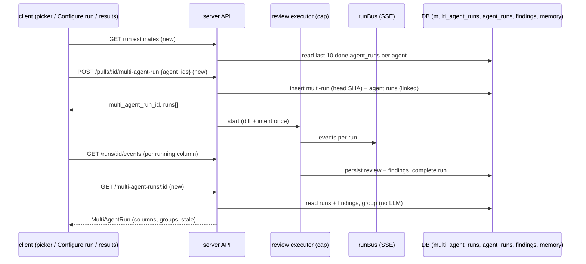
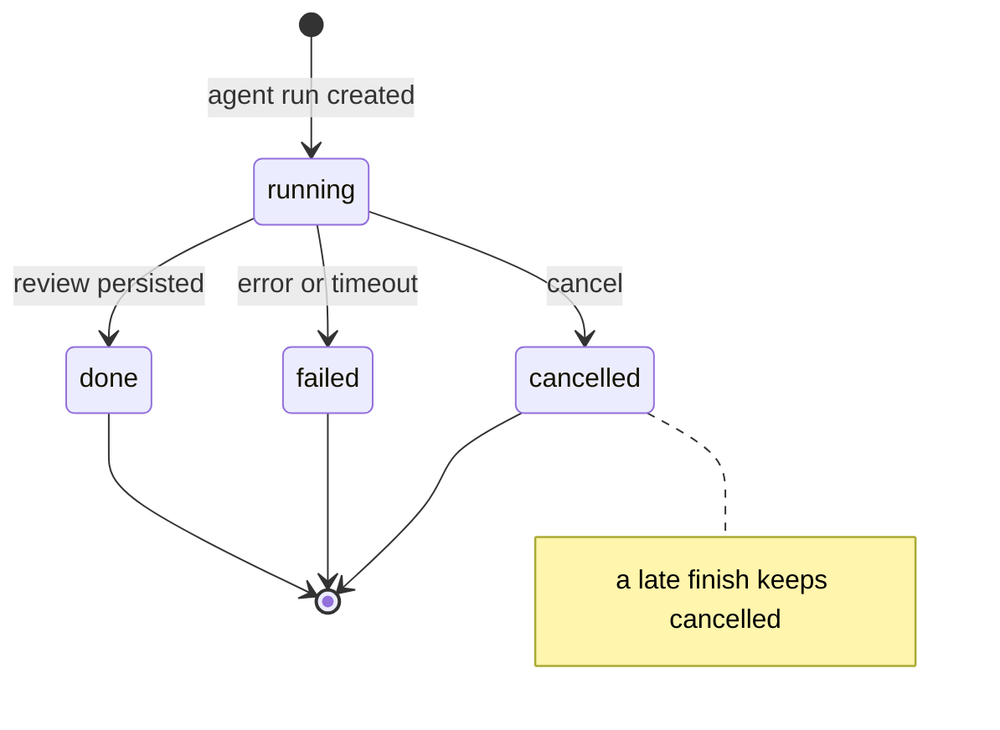

# Spec: Multi-Agent Review
Spec ID: SPEC-03-multi-agent-review
Status: approved
Supersedes: none

## Problem and user

A reviewer can run one agent on a PR, or all enabled agents. Each run shows up on its own in the
Agent runs list. Nothing lets the reviewer choose a set of agents, run them together, and
compare what each one found on the same code. Nobody can see where agents disagree, for example
when one agent flags a line and another stays silent.

The user is a developer who reviews PRs in DevDigest. They want to pick several reviewer agents,
run them on one PR at the same time, and compare the results side by side. They also want to
act on each finding without losing which agent produced it.

Today the agents of one request run one after another, not in parallel. The `multi_agent_runs`
table and the `MultiAgentRun` contract exist, but nothing writes or serves them.

## Goals / Non-goals

Goals:
- Let the user pick agents for a PR on the PR page and on a new "Configure run" screen, with a
  time and cost estimate from past runs.
- Run the chosen agents in parallel, with a cap, as one multi-run that groups every agent run.
- Show the results in two modes: Columns (live status per agent) and Tabs (finding detail with
  actions).
- Group the findings of different agents by code location without changing the stored findings
  or their per-agent attribution.
- Show "Where agents disagree", with a "Show only conflicts" toggle.
- Let the user cancel and retry agents inside one multi-run.

Non-goals:
- "Reply to author" on a finding. The design shows it, but it is out of scope.
- A Memory screen. Learn only stores a memory row (on the results page and on the PR page
  Findings tab).
- A new eval backend. "Turn into eval case" reuses the existing eval-case action.
- Reasons for "did not flag". No extra model call explains why an agent stayed silent.
- Changes to `ci/` or `agent-runner/`.
- User-chosen agent colours or icons.
- Locales other than `en`.

## User stories

- **US-1** As a reviewer, I want to pick agents on the PR page and start them in one click, so
  that I do not have to start each agent alone. → AC-1, AC-2, AC-3, AC-4, AC-5
- **US-2** As a reviewer, I want a Configure run screen with a PR picker and a time and cost
  estimate, so that I know what a run costs before I start it. → AC-6, AC-7, AC-8, AC-9,
  AC-10, AC-11, AC-12, AC-13, AC-14, AC-15, AC-16, AC-17, AC-18, AC-19
- **US-3** As a reviewer, I want the chosen agents to run in parallel as one grouped run, so
  that I get all results fast and together. → AC-20, AC-21, AC-22, AC-23, AC-24, AC-25,
  AC-26, AC-27, AC-28, AC-29, AC-30
- **US-4** As a reviewer, I want to watch each agent live in its own column and open its trace,
  so that I see progress and can inspect a run. → AC-31, AC-32, AC-33, AC-35, AC-47, AC-48,
  AC-49, AC-50, AC-51, AC-55, AC-66, AC-69, AC-71
- **US-5** As a reviewer, I want to stop or retry an agent inside the run, so that one bad
  agent does not waste money or block the comparison. → AC-42, AC-43, AC-44, AC-45, AC-46,
  AC-52, AC-53, AC-54
- **US-6** As a reviewer, I want to triage each agent's findings in a detail view, so that I
  can accept, dismiss, learn from them or turn them into eval cases. → AC-56, AC-57, AC-58,
  AC-59, AC-60, AC-61, AC-67, AC-72, AC-73, AC-74, AC-75
- **US-7** As a reviewer, I want to see where agents disagree on the same code, so that I can
  judge which agent to trust. → AC-36, AC-37, AC-38, AC-39, AC-40, AC-41, AC-62, AC-63, AC-64,
  AC-68, AC-70
- **US-8** As a reviewer, I want to know when a result is older than the PR, so that I do not
  trust results for old code. → AC-34, AC-65

## Acceptance criteria (EARS)

### Agent picker on the PR page

- **AC-1** [client] WHEN the user opens the Review menu on the PR page, the menu shall show the
  title "Pick agents to run", one checkbox row per agent of the workspace with the agent's time
  estimate, a "Clear" action, a "Run multi-agent review (N)" button and a "Configure agents…"
  link. *Verify: unit*
- **AC-2** [client] WHEN the Review menu opens, the picker shall check every enabled agent and
  leave every disabled agent unchecked. *Verify: unit*
- **AC-3** [client] WHEN the user presses "Clear", the picker shall uncheck every agent, and
  while no agent is checked the run button shall be disabled. *Verify: unit*
- **AC-4** [client] WHEN the user presses "Run multi-agent review (N)" in the picker, the client
  shall start a multi-run with the checked agents for this PR and open the results page of
  the new multi-run. *Verify: e2e*
- **AC-5** [client] WHEN the user presses "Configure agents…" in the picker, the client shall
  open the Agents page. *Verify: unit*

### Configure run screen

- **AC-6** [client] WHEN the user opens the Configure run screen of a repo, the screen shall
  show step 1 "Pull request" with a selector of the repo's pull requests and step 2 "Agents to
  run". *Verify: unit*
- **AC-7** [client] IF no pull request is selected, THEN the Configure run screen shall show the
  empty state "Pick a pull request first" in place of the agent list and disable the run
  button. *Verify: unit*
- **AC-8** [client] WHEN the Configure run URL carries `?pr=<prId>` of a PR in this repo, the
  Configure run screen shall preselect that PR. *Verify: unit*
- **AC-9** [client] WHILE a pull request is selected, the Configure run screen shall show one
  card per agent with a checkbox, the agent name, the agent description, the agent's accent
  and icon, and its estimate as "<time>s · $<cost>". *Verify: unit*
- **AC-10** [client] WHEN the user presses "Select all", the Configure run screen shall check
  every agent card. *Verify: unit*
- **AC-11** [client] The run button on the Configure run screen shall show the number of
  checked agents as "Run multi-agent review (N)" and shall be disabled while N is 0.
  *Verify: unit*
- **AC-12** [client] WHILE at least one agent is checked, the Configure run screen shall show
  next to the run button the total "≈ <max time of checked agents>s · $<sum of their costs> ·
  parallel fan-out". *Verify: unit*
- **AC-13** [client] IF a checked agent has no finished run to estimate from, THEN its card
  shall show "—" for time and cost, and the total shall leave that agent out and carry a
  "partial" mark. *Verify: unit*
- **AC-14** [client] IF the workspace has no enabled agent, THEN the Configure run screen and
  the picker shall show the existing "Enable agents to run reviews" empty state with a "Go to
  Agents" action. *Verify: unit*
- **AC-15** [server] WHEN the client asks for run estimates, the API shall return, per agent,
  the median `duration_ms` and the median non-null `cost_usd` over that agent's last 10
  `agent_runs` with status `done` on any PR, and the number of runs used. *Verify: it*
- **AC-16** [client] The client shall derive each agent's accent colour and icon from the
  agent id only, so that one agent has the same accent and icon on every screen and after
  every reload. *Verify: unit*
- **AC-17** [client] WHEN the user presses the run button on the Configure run screen, the
  client shall start a multi-run with the checked agents for the selected PR and open its
  results page. *Verify: e2e*
- **AC-18** [client] The sidebar shall show a "Multi-Agent Review" entry that opens the
  Configure run screen of the current repo. *Verify: unit*
- **AC-19** [client] IF starting a multi-run fails, THEN the client shall show a toast with the
  API error message and keep the selected PR and the checked agents. *Verify: unit*

### Starting and executing a multi-run

- **AC-20** [server] WHEN the API receives a valid multi-run request for a PR, the API shall
  create one multi-run that records the PR head SHA, create one agent run per requested agent
  linked to that multi-run, and answer with the multi-run id and the agent run ids before any
  agent finishes. *Verify: it*
- **AC-21** [server] IF the multi-run request has no agent id or more than 20 agent ids, THEN
  the API shall answer 400 and create nothing. *Verify: it*
- **AC-22** [server] IF a requested agent id does not exist in the caller's workspace, THEN the
  API shall answer 404 and create no multi-run and no agent run. *Verify: it*
- **AC-23** [server] IF the PR does not exist in the caller's workspace, THEN the API shall
  answer 404 for a multi-run request and create nothing. *Verify: it*
- **AC-24** [server] IF a multi-run request names a disabled agent, THEN the API shall run that
  agent like an enabled one. *Verify: it*
- **AC-25** [server] WHILE agent runs are executing, the server shall run at most the
  configured number of agent runs at the same time and start the next waiting agent run
  when one ends. *Verify: unit*
- **AC-26** [server] WHEN a multi-run starts, the server shall load the PR diff and resolve
  the PR intent once and share them with every agent run of that multi-run. *Verify: unit*
- **AC-27** [server] IF one agent run of a multi-run fails or times out, THEN the server shall
  mark that run `failed` with its reason and continue the other agent runs. *Verify: it*
- **AC-28** [server] IF the PR diff cannot be loaded for a multi-run, THEN every agent run of
  that multi-run shall end `failed` with the same reason. *Verify: it*
- **AC-29** [server] WHEN the API receives `POST /pulls/:id/review`, the API shall keep its
  current request and response, and the agent runs it creates shall have no multi-run link.
  *Verify: it*
- **AC-30** [server] IF a caller sends more than 10 multi-run requests in one minute, THEN the
  API shall answer 429 and create nothing for the extra requests. *Verify: it*

### Reading a multi-run

- **AC-31** [server] WHEN the API receives a read request for a multi-run, the API shall
  return the PR id and number, the run time, the agent count, one column per agent, the
  totals, the groups of findings and the stale flag. *Verify: it*
- **AC-32** [server] The API shall build each agent's column from the newest agent run of that
  agent in the multi-run, with its status (`running`, `done`, `failed` or `cancelled`), score,
  verdict, summary, duration, cost, error reason and findings. *Verify: it*
- **AC-33** [server] The API shall compute the multi-run totals from finished `done` agent runs
  only: total time as the longest `duration_ms`, and total cost as the sum of non-null
  `cost_usd`. *Verify: unit*
- **AC-34** [server] IF the current head SHA of the PR differs from the head SHA recorded on
  the multi-run, THEN the API shall mark the multi-run as stale. *Verify: it*
- **AC-35** [server] IF the multi-run id does not exist or belongs to another workspace, THEN
  the API shall answer 404. *Verify: it*

### Grouping and disagreement

- **AC-36** [server] The API shall put two persisted findings of `done` agent runs of one
  multi-run into the same group when their file is the same and their inclusive
  `[start_line, end_line]` ranges overlap, and shall join groups that share a finding.
  *Verify: unit*
- **AC-37** [server] The API shall give every `done` agent of the multi-run one take in each
  group: the severity of its most severe finding in the group, or `ignored` when it has no
  finding in the group. *Verify: unit*
- **AC-38** [server] The API shall mark a group as a conflict when at least one `done` agent
  flagged it and another `done` agent did not, or when the flagging agents gave different
  severities. *Verify: unit*
- **AC-39** [server] The API shall leave out of every group's takes the agents that are not in
  the multi-run and the agent runs whose status is `running`, `failed` or `cancelled`.
  *Verify: it*
- **AC-40** [server] The API shall order groups by file, then by first line, and shall title a
  group with the title of its most severe finding, so that the same findings always give the
  same groups in the same order. *Verify: unit*
- **AC-41** [server] The grouping shall not change, merge or delete any stored finding, and
  every finding in a group shall keep its own id, agent and run. *Verify: it*

### Cancel and retry

- **AC-42** [server] WHEN the API receives a cancel request for a multi-run, the API shall
  cancel every agent run of that multi-run whose status is `running`. *Verify: it*
- **AC-43** [server] IF an agent run finishes after it was cancelled, THEN the run shall keep
  the status `cancelled`. *Verify: it*
- **AC-44** [server] IF an agent run is cancelled before it got a free slot, THEN the server
  shall not start it and shall make no model call for it. *Verify: unit*
- **AC-45** [server] WHEN the API receives a retry request for an agent of a multi-run, the API
  shall create a new agent run of that agent linked to the same multi-run and run it.
  *Verify: it*
- **AC-46** [server] IF a retry is requested while the newest run of that agent in the
  multi-run is `running`, THEN the API shall answer 409 and create no run. *Verify: it*

### Results page

- **AC-47** [client] WHEN the user opens the results page of a multi-run, the page shall show
  the PR number and title, "<N> agents · parallel · <time>s total · $<cost>", a Columns / Tabs
  switch and a "Configure run" button that opens the Configure run screen for the same PR.
  *Verify: unit*
- **AC-48** [client] The results page shall keep the chosen mode in the URL as
  `?view=columns` or `?view=tabs` and show Columns when the URL names no mode. *Verify: unit*
- **AC-49** [client] WHILE the mode is Columns, the results page shall show one column per agent
  with its accent, name, time, cost, score ring, findings (severity, title, file and line),
  findings count and a "View trace" link. *Verify: unit*
- **AC-50** [client] WHILE an agent run is `running`, its column shall show a running status and
  the live log of that run. *Verify: unit*
- **AC-51** [client] WHEN an agent run ends, the results page shall show its final column
  without a page reload. *Verify: e2e*
- **AC-52** [client] WHILE an agent run is `failed`, its column shall show a failed status, the
  error reason, "View trace" and a "Retry" button that retries that agent in the same
  multi-run. *Verify: unit*
- **AC-53** [client] WHILE an agent run is `cancelled`, its column shall show a cancelled status
  and a "Retry" button. *Verify: unit*
- **AC-54** [client] WHILE at least one agent run of the multi-run is `running`, the results
  page shall show "Cancel all", and every running column shall show its own "Cancel" action.
  *Verify: unit*
- **AC-55** [client] WHEN the user presses "View trace" for an agent, the results page shall
  open the run trace drawer for that agent run. *Verify: unit*
- **AC-56** [client] WHILE the mode is Tabs, the results page shall show one tab per agent with
  its name and score, an agent summary card with score, summary, time, cost and "View trace",
  and the agent's findings as expandable cards with severity, title, category, file and
  lines, confidence in percent, rationale, suggested fix and the actions Accept, Dismiss,
  Learn and "Turn into eval case". *Verify: unit*
- **AC-57** [client] WHEN the user accepts or dismisses a finding on the results page, the
  client shall change only that finding, and findings of other agents in the same group
  shall stay unchanged. *Verify: unit + it*
- **AC-58** [client] The "Turn into eval case" action on the results page shall use the
  existing eval-case action, with the same enabled rule as on the PR page (disabled until the
  finding is accepted or dismissed). *Verify: unit*
- **AC-59** [server] WHEN the API receives a learn action for a finding, the API shall store
  one memory row with kind `learning`, scope `repo`, the repo of the finding's PR, the
  finding's title and rationale as content, a source that names the PR number, and no
  embedding. *Verify: it*
- **AC-60** [server] IF a learn action arrives for a finding that already produced a memory row,
  THEN the API shall answer with the existing row and store no new row. *Verify: it*
- **AC-61** [client] IF a finding action on the results page or on the PR page Findings tab
  fails, THEN the client shall show a toast with the API error message and keep the finding as
  it was. *Verify: unit*
- **AC-62** [client] The results page shall show, in both modes, "Where agents disagree" with
  one row per group: the file and line, the group title, and one cell per `done` agent that
  shows the agent name and either its severity with its finding title or "did not flag" with
  no reason text. *Verify: unit*
- **AC-63** [client] WHILE "Show only conflicts" is off, the disagreement block shall show every
  group, and WHILE it is on, the block shall show only conflict groups. *Verify: unit*
- **AC-64** [client] IF fewer than two agent runs of the multi-run are `done`, THEN the
  disagreement block shall show the text "Not enough finished agents to compare" instead of
  rows. *Verify: unit*
- **AC-65** [client] WHILE the multi-run is stale, the results page shall show the banner "PR
  changed since this run" with a link to the Configure run screen for the same PR.
  *Verify: unit*
- **AC-66** [client] IF the multi-run cannot be found, THEN the results page shall show a "Run
  not found" state with a link to the Configure run screen. *Verify: unit*
- **AC-67** [client] IF a PR title, an agent summary or a finding text contains HTML or
  Markdown, THEN the results page shall render it through the existing Markdown renderer or as
  plain text, and never as raw HTML. *Verify: unit*
- **AC-68** [server] IF findings overlap only in a chain (A overlaps B, B overlaps C, A does not
  overlap C), THEN the API shall put all three findings into one group. *Verify: unit*
- **AC-69** [server] IF every `done` agent run of the multi-run has a null `cost_usd`, THEN the
  API shall return a null total cost, never 0. *Verify: unit*
- **AC-71** [client] IF the total cost or an agent's cost is null, THEN the results page shall
  show "—" in place of that cost. *Verify: unit*
- **AC-72** [client] WHILE a finding already has a memory row from Learn, the finding card
  shall show the Learn action in a "Learned" state. *Verify: unit*
- **AC-73** [client] The finding card shall enable the Learn action whether or not the finding
  is accepted or dismissed. *Verify: unit*
- **AC-74** [client] The finding card on the PR page Findings tab shall show the Learn action
  with the same behaviour as on the results page. *Verify: unit + e2e*
- **AC-75** [server] The API shall mark each finding it returns as learned or not learned,
  based on whether a memory row from Learn exists for it. *Verify: it*
- **AC-70** [server] IF the grounding gate dropped a finding, THEN the grouping shall not use
  it, because the grouping reads only persisted findings. *Verify: it*

## Module interactions

A retry creates a new agent run in `running`. It does not reopen the old run.

Contracts at the boundary:

| Contract | Direction | Fields |
|----------|-----------|--------|
| `POST /pulls/:id/multi-agent-run` (new) | client → server | request: `agent_ids` (1–20 agent ids). Response: `multi_agent_run_id`, `pr_id`, `runs[]` (`run_id`, `agent_id`, `agent_name`). Errors: 400 (empty or more than 20 ids), 404 (PR or agent not found), 429 (rate limit). |
| `GET /multi-agent-runs/:id` (new) → `MultiAgentRun` (existing, changed) | server → client | `id`, `pr_id`, `pr_number`, `ran_at`, `agent_count`, `total_duration_ms`, `total_cost_usd`, `columns[]`, `conflicts[]`; new: `head_sha`, `stale`. Error: 404. |
| `AgentColumn` (existing, changed) | server → client | existing fields; `status` gains `cancelled`; new: `error`. The Tabs mode also needs each finding's `end_line`, `confidence`, `rationale` and `suggestion` (see Q-3). |
| `Conflict` / `ConflictTake` (existing, changed) | server → client | `file`, `line` (first line of the group), `title`, `takes[]` (`agent_id`, `persona`, `verdict` = severity or `ignored`, `note` = finding title or empty); new: `is_conflict` (boolean), because the list now holds every group. |
| `POST /multi-agent-runs/:id/cancel` (new) | client → server | response: `ok`, cancelled `run_ids[]`. Error: 404. |
| `POST /multi-agent-runs/:id/agents/:agentId/retry` (new) | client → server | response: `run_id`. Errors: 404, 409 (that agent is still running). |
| run estimates (new, route shape for the planner, Q-4) | server → client | per agent: `agent_id`, `median_duration_ms` (nullable), `median_cost_usd` (nullable), `sample_size`. |
| `POST /findings/:id/learn` (new; `learn` is already a `FindingActionKind`) | client → server | response: the memory row (`id`, `content`, `kind`, `scope`) and `created` (false when the row already existed). Error: 404. |
| `FindingRecord` and the multi-run finding (existing, changed) | server → client | new: `learned` (boolean, nullish so older payloads still parse). Read by the PR page Findings tab and the results page. |
| `POST /findings/:id/accept`, `/dismiss`, `/findings/:id/eval-case` (existing) | client → server | unchanged. |
| `GET /runs/:id/events`, `GET /runs/:id/trace`, `POST /runs/:id/cancel` (existing) | both | unchanged. |
| `POST /pulls/:id/review` (existing) | client → server | unchanged request and response. It is no longer used by the PR-page picker. |

Tables: `multi_agent_runs` (existing; new field: the PR head SHA at start). `agent_runs`
(existing; new nullable, indexed link to `multi_agent_runs`). `findings`, `reviews` (read
only). `memory` (existing; first writer). The DB gains no new table. The concurrency cap is a
server setting (A-1).

## Edge cases

- **EC-1** The user opens Configure run and has not picked a PR. → AC-7
- **EC-2** An agent has never finished a run, so it has no estimate. → AC-13
- **EC-3** The workspace has no enabled agent. → AC-14
- **EC-4** One agent fails, times out or hits a provider error while the others succeed. →
  AC-27, AC-52
- **EC-5** The request names an unknown agent, an agent of another workspace, no agent, or too
  many agents. → AC-21, AC-22
- **EC-6** The PR gets new commits after the multi-run started. → AC-34, AC-65
- **EC-7** A cancel arrives while the agent is about to finish. → AC-43
- **EC-8** A cancel arrives while the agent still waits for a free slot. → AC-44
- **EC-9** Findings overlap in a chain (A overlaps B, B overlaps C, A does not overlap C). →
  AC-36, AC-68
- **EC-10** Only one agent, or none, finished `done`. → AC-64
- **EC-11** The user retries an agent that is still running. → AC-46
- **EC-12** Finding text, agent summaries or the PR title contain HTML or Markdown. → AC-67
- **EC-13** Starting the multi-run fails, or the rate limit is hit. → AC-19, AC-30
- **EC-14** The results URL holds an unknown multi-run id, or one of another workspace. →
  AC-35, AC-66
- **EC-15** No finished agent has a priced model, so every cost is null. → AC-33, AC-69, AC-71
- **EC-16** The user presses Learn twice on the same finding. → AC-60
- **EC-17** The PR diff cannot be loaded (GitHub error, missing token). → AC-28
- **EC-18** The grounding gate dropped a finding without a real diff line. Only persisted
  findings take part in grouping. → AC-36, AC-70
- **EC-19** The user picks a disabled agent in the picker or on Configure run. → AC-24
- **EC-20** A finding action fails (network error, 404). → AC-61

## Non-functional requirements

- **NFR-1** Reliability: the server shall run at most 3 agent runs at the same time by default.
  The cap shall be configurable with a minimum of 1, where 1 means one after another.
  *Verify: unit*
- **NFR-2** Cost: a multi-run of N agents shall make the same model calls as N single agent
  runs, and grouping, estimates and the read route shall make 0 model calls. *Verify: unit*
- **NFR-3** Performance: the start request shall answer within 500 ms at p95, because no agent
  work runs before the answer. *Verify: it*
- **NFR-4** Performance: the multi-run read route shall answer within 300 ms at p95 for 5 agents
  with 50 findings each on the seeded dataset. *Verify: it*
- **NFR-5** Limits: one multi-run shall hold at most 20 agents. *Verify: it*
- **NFR-6** Security: the multi-run code shall log only ids, counts, statuses and durations,
  with 0 log lines that contain finding text, prompts or diff content. *Verify: unit*
- **NFR-7** Accessibility: the picker checkboxes, the agent cards, the Columns / Tabs switch,
  the agent tabs and the conflicts toggle shall be reachable and usable with the keyboard,
  with 0 axe violations of level A or AA. *Verify: e2e*
- **NFR-8** i18n: every user-facing string of this feature shall come from
  `client/messages/en/*.json`. *Verify: unit*

## Assumptions

- **A-1** One cap applies to the whole executor, across all PRs, and the default is 3. Source:
  research R2, which found no LLM rate limiter and found 429 retry amplification. Risk if
  wrong: one large multi-run can delay a run on another PR.
- **A-2** The cap also applies to `POST /pulls/:id/review` with `all:true`, because both share
  one executor. Risk if wrong: "Run all" becomes slower than one after another for one agent.
- **A-3** A waiting agent run (no free slot yet) shows the status `running`, and its live log
  says it waits for a slot. Risk if wrong: the user expects a separate "queued" state.
- **A-4** Median is a useful estimate after a single run (sample size 1). Risk if wrong: the
  first estimates are noisy.
- **A-5** The memory row from Learn has no confidence value. Risk if wrong: a later memory
  feature expects one and has to fill it.
- **A-6** The PR-page picker lists every agent, including disabled ones, as the current menu
  does. Risk if wrong: the list gets long in large workspaces.
- **A-7** "Configure agents…" keeps its current target, the Agents page. Risk if wrong: the user
  expected it to open the Configure run screen.
- **A-8** A new agent run of a multi-run uses the same run event stream and trace as a single
  run, so the existing live log and trace drawer work unchanged. Risk if wrong: the results
  page needs its own stream.

## Inputs and provenance

- Request: "Multi-Agent Review (worktree A)", user requirements 1–8, translated from Ukrainian.
  Boundary: PR page, Multi-Agent Review, the multi-run service and its new files; no change to
  `ci/` or `agent-runner/`.
- Designs (read): PR page picker
  (`335c803e-…/content.png`), Configure run empty (`65183690-…/content.png`), Configure run with PR
  (`93b905c3-…/content.png`), Results Columns (`431fe615-…/content.png`), Results Tabs
  (`eb146e8e-…/content.png`).
- Code read: `server/src/db/schema/{runs,reviews,eval,knowledge,agents,pulls}.ts`,
  `server/src/modules/reviews/{routes,service,run-executor,findings}.ts`,
  `server/src/modules/reviews/repository/run.repo.ts`, `server/src/modules/eval/routes.ts`,
  `server/src/vendor/shared/contracts/{observability,platform,findings,knowledge}.ts`,
  `reviewer-core/src/review/reduce.ts`, `client/src/app/repos/[repoId]/pulls/[number]/_components/{RunReviewDropdown,FindingCard}`,
  `client/src/lib/hooks/reviews.ts`, `client/src/components/app-shell/helpers.ts`,
  `client/src/vendor/ui/nav.ts`, `client/messages/en/runs.json`.
- INSIGHTS: `server/INSIGHTS.md`, `client/INSIGHTS.md`, root `INSIGHTS.md`. Most relevant: trace
  fields must be nullish; per-run stats live on `agent_runs`, not on reviews; a nav entry in
  `vendor/ui/nav.ts` is an allowed exception.
- Existing spec: `specs/eval-pipeline.md` (the eval-case action and its triage rule).
- Research R1: there was no earlier implementation in this branch's history. Reference
  implementations exist on upstream branches only. They are hints for the planner, not
  requirements.
- Research R2: running agent runs at the same time is safe, because run state is kept per run
  id and the pre-work runs once. A cap is needed. A cancelled run could be overwritten as
  `done` (AC-43).
- Round 1 answers:
  - Run route → a new multi-run route; `/pulls/:id/review` unchanged (AC-20, AC-29).
  - Run link → a nullable, indexed link column on `agent_runs` (Module interactions).
  - Parallel → yes, with a cap (AC-25, NFR-1).
  - Turn into eval case → reuse the existing eval-case action (AC-58).
  - Learn → one memory row: kind learning, scope repo, title and rationale, no embedding
    (AC-59).
  - Disagree set → only `done` agents of this multi-run (AC-39).
  - Grouping → same file, inclusive line-range overlap, transitive, no LLM (AC-36).
  - After Run in the picker → open the results page; the picker replaces the old menu items;
    any N ≥ 1 creates a multi-run (AC-4).
  - Show only conflicts → off shows all groups, on shows conflicts only (AC-63).
  - "did not flag" → no reason text (AC-62, Non-goal).
  - Routes → `/repos/:repoId/multi-agent?pr=` and `/repos/:repoId/multi-agent/:multiRunId`,
    plus a sidebar entry (AC-8, AC-18).
  - Estimate → median of the last 10 done runs per agent; total time = max, cost = sum; no
    history shows "—" and a partial total (AC-12, AC-13, AC-15).
  - Defaults → all enabled agents checked; button disabled with no PR or 0 agents; existing
    empty state (AC-2, AC-7, AC-11, AC-14).
  - Card text → the agent description (AC-9).
- Round 2 answers:
  - Learn twice → idempotent: the existing memory row is returned, no new row, and the button
    shows "Learned" (AC-60, AC-72, AC-75).
  - Learn needs triage → no; Learn works on any finding (AC-73).
  - Learn on the PR page → yes, on the Findings tab finding card too (AC-61, AC-74).
  - Group title → the title of the most severe finding, confirmed (AC-40).
  - A-3, A-6, A-7 → confirmed as written.
  - Failures → failed column with Retry into the same multi-run; failed agents left out of the
    disagreements; totals from finished agents (AC-33, AC-39, AC-45, AC-52).
  - Cancel → Cancel all and per column, with a new `cancelled` status (AC-42, AC-54).
  - Accept / Dismiss → that agent's finding only (AC-57).
  - Reply to author → out of scope (Non-goal).
  - Agent look → accent and icon derived from the agent id (AC-16).
  - Re-runs → every multi-run is kept; stale banner on a head SHA mismatch (AC-34, AC-65).
  - View in URL, Columns by default, header copy, null cost as "—", live log per running
    column (AC-47, AC-48, AC-50).

## Untrusted inputs

- PR title and PR head SHA come from GitHub. The client renders the title as plain text
  (AC-67).
- Finding title, rationale, suggestion and agent summary are model output. The client renders
  them only through the existing Markdown renderer, with no raw HTML (AC-67). Learn stores them
  as data and never runs them.
- Agent name and description are user input. The client renders them as plain text.
- `agent_ids` in the start request come from the client. The API checks each id against the
  caller's workspace (AC-22) and the count (AC-21).
- URL values `pr`, `view` and `multiRunId` come from the address bar. The client ignores an
  unknown `view` and falls back to Columns. An unknown `pr` leaves the selector empty. An
  unknown run shows "Run not found" (AC-66).
- API responses are checked against the shared contracts before use.

## Open questions

- **Q-3** (planner) Should the Tabs mode get the extra finding fields by extending
  `AgentColumnFinding`, or by joining the existing reviews read for the PR?
- **Q-4** (planner) The route shape and placement of the run-estimate read, for example one
  call for all agents of the workspace.
- **Q-5** (planner) Where the grouping logic lives (a pure helper in the server module or in
  `reviewer-core`), and how the cap setting is named.

## Traceability

| AC | Stories | Edge cases | NFR | Verify |
|----|---------|------------|-----|--------|
| AC-1 | US-1 | EC-19 | NFR-7, NFR-8 | unit |
| AC-2 | US-1 | — | — | unit |
| AC-3 | US-1 | — | — | unit |
| AC-4 | US-1 | — | — | e2e |
| AC-5 | US-1 | — | — | unit |
| AC-6 | US-2 | — | NFR-8 | unit |
| AC-7 | US-2 | EC-1 | — | unit |
| AC-8 | US-2 | — | — | unit |
| AC-9 | US-2 | — | — | unit |
| AC-10 | US-2 | — | — | unit |
| AC-11 | US-2 | EC-1 | — | unit |
| AC-12 | US-2 | — | — | unit |
| AC-13 | US-2 | EC-2 | — | unit |
| AC-14 | US-2 | EC-3 | — | unit |
| AC-15 | US-2 | EC-2 | NFR-2 | it |
| AC-16 | US-2 | — | — | unit |
| AC-17 | US-2 | — | NFR-7 | e2e |
| AC-18 | US-2 | — | — | unit |
| AC-19 | US-2 | EC-13 | — | unit |
| AC-20 | US-3 | — | NFR-3 | it |
| AC-21 | US-3 | EC-5 | NFR-5 | it |
| AC-22 | US-3 | EC-5 | — | it |
| AC-23 | US-3 | — | — | it |
| AC-24 | US-3 | EC-19 | — | it |
| AC-25 | US-3 | — | NFR-1 | unit |
| AC-26 | US-3 | — | NFR-2 | unit |
| AC-27 | US-3 | EC-4 | — | it |
| AC-28 | US-3 | EC-17 | — | it |
| AC-29 | US-3 | — | — | it |
| AC-30 | US-3 | EC-13 | — | it |
| AC-31 | US-4 | — | NFR-4 | it |
| AC-32 | US-4 | — | — | it |
| AC-33 | US-4 | EC-15 | — | unit |
| AC-34 | US-8 | EC-6 | — | it |
| AC-35 | US-4 | EC-14 | — | it |
| AC-36 | US-7 | EC-9, EC-18 | NFR-2 | unit |
| AC-37 | US-7 | — | — | unit |
| AC-38 | US-7 | — | — | unit |
| AC-39 | US-7 | EC-4 | — | it |
| AC-40 | US-7 | — | — | unit |
| AC-41 | US-7 | — | — | it |
| AC-42 | US-5 | — | — | it |
| AC-43 | US-5 | EC-7 | — | it |
| AC-44 | US-5 | EC-8 | NFR-2 | unit |
| AC-45 | US-5 | — | — | it |
| AC-46 | US-5 | EC-11 | — | it |
| AC-47 | US-4 | EC-15 | NFR-8 | unit |
| AC-48 | US-4 | — | — | unit |
| AC-49 | US-4 | — | NFR-7 | unit |
| AC-50 | US-4 | — | — | unit |
| AC-51 | US-4 | — | — | e2e |
| AC-52 | US-5 | EC-4 | — | unit |
| AC-53 | US-5 | — | — | unit |
| AC-54 | US-5 | — | — | unit |
| AC-55 | US-4 | — | — | unit |
| AC-56 | US-6 | — | NFR-7 | unit |
| AC-57 | US-6 | — | — | unit + it |
| AC-58 | US-6 | — | — | unit |
| AC-59 | US-6 | — | NFR-6 | it |
| AC-60 | US-6 | EC-16 | — | it |
| AC-61 | US-6 | EC-20 | — | unit |
| AC-62 | US-7 | — | NFR-8 | unit |
| AC-63 | US-7 | — | NFR-7 | unit |
| AC-64 | US-7 | EC-10 | — | unit |
| AC-65 | US-8 | EC-6 | — | unit |
| AC-66 | US-4 | EC-14 | — | unit |
| AC-67 | US-6 | EC-12 | — | unit |
| AC-68 | US-7 | EC-9 | — | unit |
| AC-69 | US-4 | EC-15 | — | unit |
| AC-70 | US-7 | EC-18 | — | it |
| AC-71 | US-4 | EC-15 | — | unit |
| AC-72 | US-6 | EC-16 | — | unit |
| AC-73 | US-6 | — | — | unit |
| AC-74 | US-6 | — | — | unit + e2e |
| AC-75 | US-6 | EC-16 | — | it |
