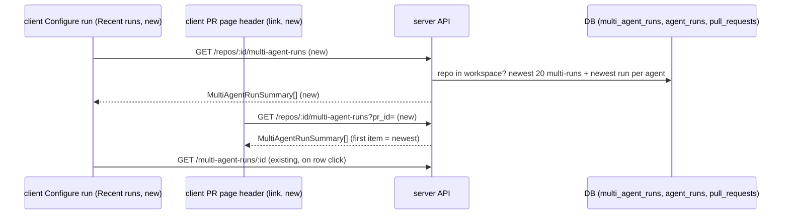

# Spec: Multi-Agent Run History
Spec ID: SPEC-04-multi-agent-run-history
Status: approved
Supersedes: none

## Problem and user

SPEC-03 (`specs/multi-agent-review.spec.md`) added multi-runs and their results page. Once the
user leaves a results page, there is no way back to it. The sidebar entry "Multi-Agent Review"
opens the Configure run screen. Nothing lists or links the multi-runs that already exist. The
results page URL is the only way in.

The user is a developer who reviews PRs in DevDigest. They want to find a multi-run they
started earlier and open its results again, from the Multi-Agent Review screen and from the PR
page.

This spec is additive. It does not change any behaviour of SPEC-03.

## Goals / Non-goals

Goals:
- Show a "Recent runs" list of the current repo's latest multi-runs on the Configure run screen.
- Show an "Open multi-agent review" link on the PR page that opens the newest multi-run of
  that PR.
- Serve both from one new, workspace-scoped list route that makes no model call and no GitHub
  call.

Non-goals:
- Pagination, "Show more", search or filters in the Recent runs list. The list shows a fixed
  number of rows (A-1).
- Deleting or renaming a multi-run.
- A stale mark ("PR changed since this run") in the list. The results page already shows it
  (SPEC-03 AC-65).
- A list of all multi-runs of a PR on the PR page. The PR page links only the newest one.
- Live updates over SSE for the list. The list refreshes by reading the route again (AC-20).
- Changes to the MCP server.
- Locales other than `en`.

## User stories

- **US-1** As a reviewer, I want a list of recent multi-runs on the Multi-Agent Review screen,
  so that I can reopen the results of a run I started earlier. → AC-1, AC-2, AC-3, AC-4, AC-5,
  AC-6, AC-7, AC-8, AC-11, AC-12, AC-13, AC-14, AC-15, AC-16, AC-17, AC-18, AC-19, AC-20,
  AC-21, AC-22, AC-27, AC-28, AC-29, AC-30, AC-31, AC-32
- **US-2** As a reviewer, I want a link on the PR page to the newest multi-run of that PR, so
  that I can go from the PR to its multi-agent results in one click. → AC-9, AC-10, AC-23,
  AC-24, AC-25
- **US-3** As a reviewer, I want the results page breadcrumb to lead back to the Multi-Agent
  Review screen, so that I can move between a result and the list. → AC-26

## Acceptance criteria (EARS)

### List route

- **AC-1** [server] WHEN the API receives `GET /repos/:id/multi-agent-runs` for a repo of the
  caller's workspace, the API shall return the multi-runs whose PR belongs to that repo,
  ordered by `ran_at` newest first, then by `id` descending. *Verify: it*
- **AC-2** [server] IF the repo, or the PR named by `pr_id`, has more than 20 multi-runs, THEN
  the API shall return only the 20 newest of them. *Verify: it*
- **AC-3** [server] The API shall return each list item with `id`, `pr_id`, `pr_number`,
  `pr_title`, `ran_at`, `agent_count`, `status`, `total_duration_ms` and `total_cost_usd`.
  *Verify: it*
- **AC-4** [server] The API shall compute `agent_count`, `status` and the totals of a list item
  from the newest agent run of each agent in that multi-run, so that they match the columns of
  `GET /multi-agent-runs/:id` for the same multi-run. *Verify: it*
- **AC-31** [server] IF an agent was retried inside a multi-run, THEN the API shall count only
  the newest agent run of that agent for the list item's `agent_count`, `status` and totals.
  *Verify: it*
- **AC-5** [server] IF at least one counted agent run of a multi-run is `running`, THEN the API
  shall set the list item's `status` to `running`, whatever the other agent runs are.
  *Verify: unit*
- **AC-27** [server] WHEN a multi-run has at least one counted agent run and every counted agent
  run is `done`, the API shall set the list item's `status` to `done`. *Verify: unit*
- **AC-28** [server] IF no counted agent run is `running`, at least one is `done`, and at least
  one is `failed` or `cancelled`, THEN the API shall set the list item's `status` to `partial`.
  *Verify: unit*
- **AC-29** [server] IF a multi-run has at least one counted agent run and none of them is
  `running` or `done`, THEN the API shall set the list item's `status` to `failed`.
  *Verify: unit*
- **AC-6** [server] IF a multi-run has no counted agent run (for example, every agent was
  deleted), THEN the API shall return it with `agent_count` 0 and `status` `failed`.
  *Verify: unit*
- **AC-7** [server] The API shall compute `total_duration_ms` and `total_cost_usd` of a list
  item with the same rule as SPEC-03 AC-33 and AC-69: the longest duration and the sum of
  non-null costs of `done` agent runs, with a null cost when no `done` run has a cost.
  *Verify: unit*
- **AC-8** [server] IF the repo has no multi-run, THEN the API shall answer 200 with an empty
  list. *Verify: it*
- **AC-9** [server] WHEN the list request carries the query value `pr_id` of a PR in that repo,
  the API shall return only the multi-runs of that PR, with the same order and limit as AC-1
  and AC-2. *Verify: it*
- **AC-10** [server] IF `pr_id` names a PR that does not exist, or that belongs to another repo
  or another workspace, THEN the API shall answer 404. *Verify: it*
- **AC-11** [server] IF the repo id does not exist or belongs to another workspace, THEN the API
  shall answer 404. *Verify: it*
- **AC-12** [server] IF the repo id or `pr_id` is not a valid UUID, THEN the API shall answer
  422, like every other route with an id. *Verify: it*
- **AC-13** [server] IF no GitHub token is configured or GitHub cannot be reached, THEN the list
  route shall answer from the database with the same result as with a working token.
  *Verify: unit*

### Recent runs list on the Configure run screen

- **AC-14** [client] WHEN the user opens the Configure run screen of a repo, the screen shall
  show a "Recent runs" section below the configure form, with one row per list item in the
  order the API returns. *Verify: unit*
- **AC-15** [client] The Recent runs section shall show in each row "#<PR number> · <PR title>",
  the start time as a relative time with the full date and time on hover, "<N> agents", a
  status badge ("Running", "Done", "Partial" or "Failed"), the total time as "<seconds>s" and
  the total cost. *Verify: unit*
- **AC-30** [client] IF a PR title contains HTML or Markdown, THEN the Recent runs row shall show
  it as plain text and never render it as HTML. *Verify: unit*
- **AC-16** [client] IF a row's total cost is null, THEN the row shall show "—" for the cost.
  *Verify: unit*
- **AC-32** [client] IF a row's `total_duration_ms` is 0, THEN the row shall show "—" for the
  time. *Verify: unit*
- **AC-17** [client] WHEN the user clicks a row, or focuses it and presses Enter, the client
  shall open `/repos/:repoId/multi-agent/:multiRunId` for that multi-run. *Verify: unit*
- **AC-18** [client] WHILE the list is loading, the Recent runs section shall show skeleton
  rows, and the configure form above it shall stay usable. *Verify: unit*
- **AC-19** [client] IF the list is empty, THEN the Recent runs section shall show the empty
  state "No multi-agent runs yet" with the text "Runs you start here appear in this list.".
  *Verify: unit*
- **AC-20** [client] WHILE at least one row has status `running`, the Recent runs section shall
  show each row's new status and totals within 5 seconds after the API reports them, without a
  page reload. *Verify: unit*
- **AC-21** [client] IF the list request fails, THEN the Recent runs section shall show an error
  state "Could not load recent runs" with a Retry action, and the configure form shall stay
  usable. *Verify: unit*
- **AC-22** [client] WHEN the user starts a multi-run and then comes back to the Configure run
  screen of the same repo, the Recent runs list shall show that multi-run as its first row.
  *Verify: e2e*

### Link on the PR page

- **AC-23** [client] WHILE the PR has at least one multi-run, the PR page header shall show an
  "Open multi-agent review" link that opens the results page of the newest multi-run of that
  PR. *Verify: unit*
- **AC-24** [client] IF the PR has no multi-run, or its multi-run list is still loading or
  failed to load, THEN the PR page header shall show no "Open multi-agent review" link and no
  error message for it. *Verify: unit*
- **AC-25** [client] WHEN the user starts a multi-run from the Review menu and then goes back to
  the PR page, the "Open multi-agent review" link shall open that new multi-run. *Verify: e2e*

### Results page breadcrumb

- **AC-26** [client] The results page shall show the breadcrumb "Multi-Agent Review › #<PR
  number>", where "Multi-Agent Review" opens the Configure run screen of the same repo.
  *Verify: unit*

## Module interactions

Contracts at the boundary:

| Contract | Direction | Fields |
|----------|-----------|--------|
| `GET /repos/:id/multi-agent-runs` (new) | client → server | query: `pr_id` (optional UUID). Response: array of `MultiAgentRunSummary`, at most 20, newest first. Errors: 404 (repo, or `pr_id` PR, not found in this repo and workspace), 422 (an id is not a UUID). |
| `MultiAgentRunSummary` (new) | server → client | `id`, `pr_id`, `pr_number` (int), `pr_title` (string), `ran_at` (ISO time), `agent_count` (int), `status` (`running` \| `done` \| `partial` \| `failed`), `total_duration_ms` (int, 0 when no agent is `done`), `total_cost_usd` (number, nullable). |
| `GET /multi-agent-runs/:id` → `MultiAgentRun` (existing) | server → client | unchanged. The results page opened from a row or from the PR link reads it as before. |
| `GET /repos/:id/pulls`, `GET /pulls/:id` (existing) | server → client | unchanged. |

Tables: `multi_agent_runs`, `agent_runs`, `pull_requests` are read only. The DB gains no new
table. A multi-run belongs to a repo through its PR (`multi_agent_runs.pr_id` →
`pull_requests.repo_id`).

## Edge cases

- **EC-1** The repo has no multi-run yet. → AC-8, AC-19
- **EC-2** A multi-run still has running agents while the list is shown. → AC-5, AC-20
- **EC-3** Some agents of a multi-run failed or were cancelled, others are done, or none is
  done. → AC-28, AC-29
- **EC-4** Every agent of a multi-run was deleted, so no agent run is counted. → AC-6
- **EC-5** No `done` agent run has a cost, or no agent is `done` yet. → AC-7, AC-16, AC-32
- **EC-6** The repo has more than 20 multi-runs. → AC-2
- **EC-7** The URL holds a repo id of another workspace, an unknown repo, or a non-UUID value.
  → AC-11, AC-12
- **EC-8** The `pr_id` names a PR of another repo or workspace. → AC-10
- **EC-9** The list request fails (API down, 5xx). → AC-21, AC-24
- **EC-10** The PR has no multi-run. → AC-24
- **EC-11** The PR title contains HTML or Markdown. → AC-30
- **EC-12** No GitHub token is configured, or GitHub cannot be reached. → AC-13
- **EC-13** A retry inside a multi-run creates a newer run of the same agent. → AC-4, AC-31

## Non-functional requirements

- **NFR-1** Performance: the list route shall answer within 200 ms at p95 for a repo with 500
  multi-runs of 5 agent runs each. *Verify: it*
- **NFR-2** Cost: the list route shall make 0 model calls and 0 GitHub calls. *Verify: unit*
- **NFR-3** Limits: the list shall return and the client shall render at most 20 rows.
  *Verify: it + unit*
- **NFR-4** Security: the list code shall log only ids, counts, statuses and durations, with 0
  log lines that contain a PR title. *Verify: unit*
- **NFR-5** Accessibility: every Recent runs row and the "Open multi-agent review" link shall be
  reachable with Tab and usable with Enter, with 0 axe violations of level A or AA on the
  Configure run screen. *Verify: e2e*
- **NFR-6** i18n: every user-facing string of this feature shall come from
  `client/messages/en/*.json`. *Verify: unit*

## Assumptions

- **A-1** A fixed limit of 20 rows is enough to find a recent multi-run, and older runs do not
  need to be reachable from the list. Risk if wrong: a user with many runs cannot reach an old
  one without its URL.
- **A-2** One route serves both entry points: the PR page uses the `pr_id` filter and takes the
  first item. Risk if wrong: the PR page reads up to 20 items when it needs one.
- **A-3** A `cancelled` agent run counts as "not done" for the status, the same as `failed`.
  Risk if wrong: a multi-run the user cancelled on purpose shows "Partial" or "Failed".
- **A-4** The status names `running`, `done`, `partial`, `failed` and their labels "Running",
  "Done", "Partial", "Failed" match what the user means by "running / done / partial-failed".
  Risk if wrong: copy changes only.
- **A-5** The list shows the start time as a relative time ("5 min ago") with the full date and
  time on hover. Risk if wrong: copy and formatting change only.
- **A-6** A row is one link that opens the results page in the same tab. Risk if wrong: the user
  expects a separate "Open" button.
- **A-7** The PR page link sits in the PR header actions, next to the Review menu, and is shown
  for a running multi-run too. Risk if wrong: a layout change only.
- **A-8** A refresh every few seconds while a row is running is cheap enough, because the route
  reads only the DB (NFR-1, NFR-2). Risk if wrong: extra DB load while long runs are open.
- **A-9** The 200 ms p95 target follows SPEC-03 NFR-4 (300 ms for one full multi-run read); the
  list reads no findings, so it is lighter. Risk if wrong: the planner needs an index on
  `multi_agent_runs` for the repo order.
- **A-10** The results page breadcrumb "Multi-Agent Review › #<PR number>" already exists; AC-26
  pins it so a later change does not break the way back. Risk if wrong: none for scope.

## Inputs and provenance

- Request: the user, during manual acceptance of SPEC-03 on 2026-10-11: "once you leave a
  multi-agent results page there is no way back to it". The sidebar opens Configure run, and
  nothing lists or links existing multi-runs.
- User decision, made before this spec: both entry points. (1) A Recent runs list below the
  configure form, with PR number and title, start time, agent count, aggregate status, totals
  (cost "—" when null), opening the results page; a new workspace-scoped list route. (2) An
  "Open multi-agent review" link on the PR page to the newest multi-run of that PR, shown only
  when one exists. → AC-1 to AC-25.
- User instruction for small choices: propose defaults and record them as assumptions, not as
  blocking questions. → A-1 to A-10.
- Design: the breadcrumb "Multi-Agent Review › #482" for a results page (described in the
  request; no image read). → AC-26.
- Parent spec (read, not changed): `specs/multi-agent-review.spec.md` (SPEC-03), AC-33, AC-35,
  AC-47, AC-65, AC-69, NFR-4.
- Code read: `server/src/modules/reviews/{routes,multi-run-service}.ts`,
  `server/src/modules/reviews/repository/multi-run.repo.ts`,
  `server/src/db/schema/runs.ts` (`multi_agent_runs`, `agent_runs.multi_agent_run_id`),
  `server/src/db/schema/pulls.ts`, `server/src/modules/pulls/routes.ts` (repo 404 pattern),
  `server/src/modules/_shared/schemas.ts` (`IdParams`), `server/src/app.ts` (validation → 422),
  `server/src/vendor/shared/contracts/observability.ts` (`MultiAgentRun`),
  `client/src/app/repos/[repoId]/multi-agent/**` (Configure run view, results view and its
  breadcrumb), `client/src/lib/hooks/multi-agent.ts`,
  `client/src/app/repos/[repoId]/pulls/[number]/_components/PrDetailHeader/PrDetailHeader.tsx`,
  `client/messages/en/multiAgent.json`.
- INSIGHTS: `server/INSIGHTS.md`, `client/INSIGHTS.md`, root `INSIGHTS.md`. Most relevant: a
  query over child rows must keep the workspace check in the query (cross-workspace fixture in
  the `it` test); a disabled query must gate on `isPending`, not `isLoading` (AC-24 hides the
  link while loading); mutation errors already toast globally, so the list error is shown in
  place, not as a second toast (AC-21).

## Untrusted inputs

- PR title comes from GitHub. The client renders it as plain text, never as HTML (AC-15).
- `repoId` and `multiRunId` come from the address bar. The API checks the repo against the
  caller's workspace (AC-11, AC-12). An unknown multi-run shows SPEC-03's "Run not found".
- `pr_id` comes from the client. The API checks it against the repo and the workspace (AC-10,
  AC-12).
- API responses are checked against the shared contracts before use.

## Open questions

- **Q-1** (planner) Whether the list needs a new index (for example on `multi_agent_runs` by
  workspace and `ran_at`) to meet NFR-1, and how the list reuses the status and totals logic of
  the multi-run read.

## Traceability

| AC | Stories | Edge cases | NFR | Verify |
|----|---------|------------|-----|--------|
| AC-1 | US-1 | — | NFR-1 | it |
| AC-2 | US-1 | EC-6 | NFR-3 | it |
| AC-3 | US-1 | — | — | it |
| AC-4 | US-1 | EC-13 | — | it |
| AC-5 | US-1 | EC-2 | — | unit |
| AC-27 | US-1 | — | — | unit |
| AC-28 | US-1 | EC-3 | — | unit |
| AC-29 | US-1 | EC-3 | — | unit |
| AC-31 | US-1 | EC-13 | — | it |
| AC-6 | US-1 | EC-4 | — | unit |
| AC-7 | US-1 | EC-5 | — | unit |
| AC-8 | US-1 | EC-1 | — | it |
| AC-9 | US-2 | — | — | it |
| AC-10 | US-2 | EC-8 | — | it |
| AC-11 | US-1 | EC-7 | — | it |
| AC-12 | US-1 | EC-7 | — | it |
| AC-13 | US-1 | EC-12 | NFR-2 | unit |
| AC-14 | US-1 | — | NFR-6 | unit |
| AC-15 | US-1 | — | NFR-4, NFR-6 | unit |
| AC-30 | US-1 | EC-11 | — | unit |
| AC-16 | US-1 | EC-5 | — | unit |
| AC-32 | US-1 | EC-5 | — | unit |
| AC-17 | US-1 | — | NFR-5 | unit |
| AC-18 | US-1 | — | — | unit |
| AC-19 | US-1 | EC-1 | NFR-6 | unit |
| AC-20 | US-1 | EC-2 | — | unit |
| AC-21 | US-1 | EC-9 | — | unit |
| AC-22 | US-1 | — | — | e2e |
| AC-23 | US-2 | — | NFR-5 | unit |
| AC-24 | US-2 | EC-9, EC-10 | — | unit |
| AC-25 | US-2 | — | — | e2e |
| AC-26 | US-3 | — | — | unit |
